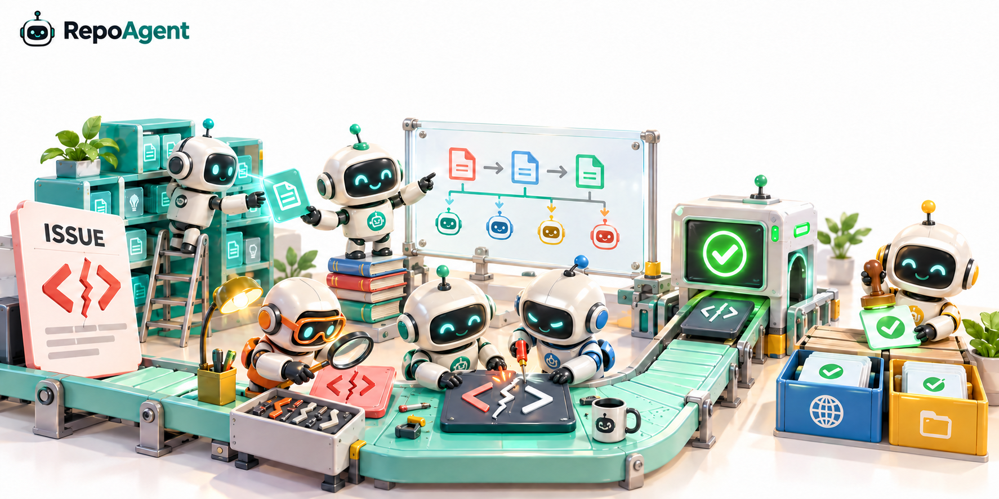
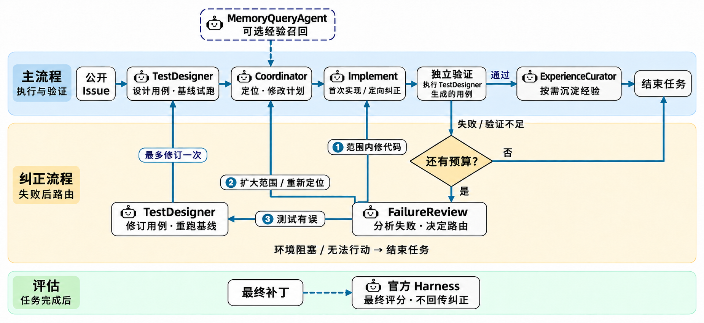
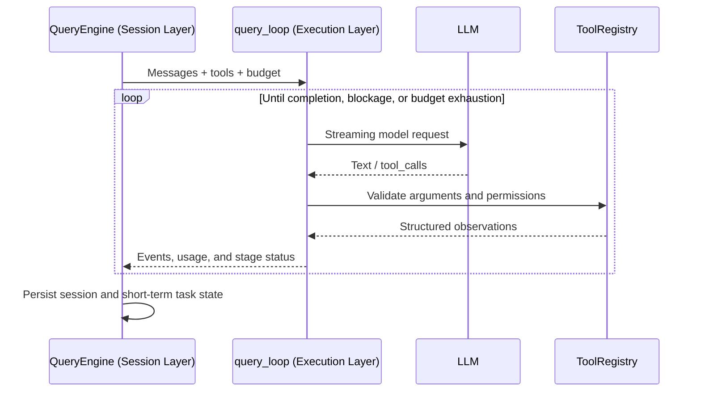
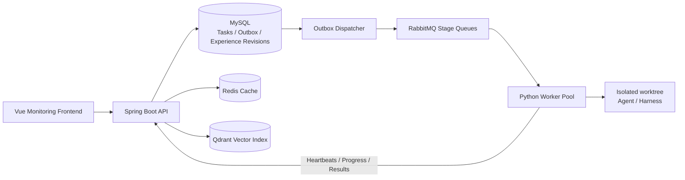

<div align="center">

# RepoAgent

[简体中文](README.md) | **English**



### Give an Issue to a repair team with a role for every step.

**Experience Retrieval · Collaborative Diagnosis · Targeted Repair · Continuous Learning**

[Meet the Team](#meet-the-team) · [Repair Workflow](#repair-workflow) · [Memory and Retrieval](#memory-and-retrieval) · [Backend](#backend) · [Results](#swe-bench-lite-results) · [Quick Start](https://github.com/Artoriazzz/RepoAgent/blob/full-stack-integration/docs/quickstart.md)

</div>

---

RepoAgent is a multi-agent program repair platform for software repositories. It brings together public Issues, source code, repair experience, and execution tools in a collaborative pipeline.

Each role has its own context and receives the information needed for its current stage: **the query agent finds reusable experience, the coordinator decides the repair strategy, the implementer changes code, the failure analyst diagnoses unsuccessful attempts, and the curator distills knowledge from verified repairs.**

The platform includes a Python Agent Runtime, a Spring Boot backend, and a Vue monitoring frontend. The runtime uses the OpenAI-compatible `tools/tool_calls` protocol directly, implementing session management, tool execution, streaming responses, budget control, and role scheduling.

The complete platform is on the [full-stack-integration branch](https://github.com/Artoriazzz/RepoAgent/tree/full-stack-integration). The `main` branch contains the Python Agent Runtime, Worker, and experiment tools.

## Why Multiple Agents

| Common Challenge | RepoAgent's Approach |
| --- | --- |
| Reading a lot of code still leaves the edit location unclear | The Coordinator investigates key unknowns and produces a behavior contract and an EditBrief |
| Removing an exception introduces regressions on valid inputs | Existing behavior to preserve is handed to the implementer; independent validation checks the target behavior and regressions |
| Long failure logs lead to shifting correction strategies | FailureReview extracts concrete failures, invalidated assumptions, and actionable correction evidence |
| Similar problems require repeated investigation | Global and repository experience is retrieved for the Coordinator to check against the current source |
| Concurrent repair tasks compete for resources or mix contexts | Stage queues schedule work, stateless runtimes reuse clients, and independent sessions isolate task state |

## Meet the Team

**New in this version: [Public Test Agent](docs/public-validation.md).** It designs tests independently from the public issue, source code, and existing tests. It runs them on the original baseline and freezes the suite for patch verification. Reproducible failures can guide corrections; the official harness is reserved for final scoring in this workflow. The agent is integrated with the CLI and SWE-bench batch runner; backend queue integration is pending.

### Main Roles

| Role | Responsibility | Deliverables |
| --- | --- | --- |
| **MemoryQueryAgent: Experience Query** | Extracts the problem description and usage scenario from a public Issue to form an independent retrieval query | `problem_description`, `usage_scenario` |
| **Coordinator: Diagnosis and Decisions** | Combines retrieved experience, the current Issue, and source code to identify the faulty operation and decide the repair strategy and edit scope | Problem Contract, source evidence, EditBrief, authorized files and line ranges |
| **TestDesigner: Test Design** | Designs issue-driven tests independently from the repair plan, runs the original baseline, and revises faulty generated cases when routed by FailureReview | Executable cases, baseline results, frozen suite versions, patched results |
| **Initial Implement: First Repair** | Applies the EditBrief within the authorized scope and reports direct counterevidence and known risks | Initial patch, completion status, risk notes |
| **FailureReview: Failure Analysis** | Examines validation failures and authorized source code to identify semantic errors, missed paths, or environment failures | Evidence, invalidated assumptions, correction suggestions, scope adjustment needs |
| **Corrective Implement: Targeted Correction** | Revises the existing patch using the failure analysis and current authorization | Corrected patch, change notes, remaining risks |
| **ExperienceCurator: Experience Curation** | Abstracts knowledge after successful independent validation, checks for duplicates, and maintains existing experience | Global and repository experience, with add/merge/no-change decisions |

## Repair Workflow

**TestDesigner prepares tests independently before any code changes.** It uses the public issue, unmodified source, and existing repository tests to design cases, runs them on the original baseline, and freezes usable tests. Test preparation is decoupled from the Coordinator: initial test results are not injected into its context. Optional memory retrieval goes only to the Coordinator.

The Coordinator delivers an EditBrief, Implement produces the initial patch, and independent validation executes the frozen TestDesigner-generated cases. Failure or insufficient validation triggers a budget check. FailureReview routes actionable code defects to Implement, broader scope or localization changes to the Coordinator, and generated-test defects to TestDesigner for one revision and a new baseline run. Every corrected patch returns to the same validation stage.



This diagram describes the TestDesigner-generated-test workflow. Test revisions record a new suite version and baseline; ordinary code corrections reuse frozen tests. Insufficient validation is not counted as success. Retrieval, curation, and correction budgets depend on configuration. Official Harness scores do not feed corrections in this workflow. TestDesigner is integrated with the CLI and SWE-bench batch runner; backend stage-queue integration is still pending. See the [runtime guide](https://github.com/Artoriazzz/RepoAgent/blob/full-stack-integration/docs/quickstart.md#运行流程与入口) for entry points and budgets.

Three handoffs keep responsibilities explicit:

1. **Experience → Decisions**: Retrieved knowledge enters the Coordinator, which checks its applicability against the current Issue and source code.
2. **Decisions → Implementation**: The EditBrief carries the target behavior, rationale, authorization scope, and existing behavior to preserve.
3. **Validation → Learning**: Successful repairs yield reusable experience. Similar knowledge is merged; entries remain unchanged when no useful knowledge is added.

## Memory and Retrieval

### Global and Repository Experience

| Type | Purpose | Stored Knowledge |
| --- | --- | --- |
| **Global experience** `global_experience` | Recognize similar failure mechanisms across repositories | Problem mechanisms, applicability conditions, general repair steps, validation approaches, and disproven approaches |
| **Repository experience** `repository_experience` | Locate the right implementation layer within the current repository | Stable modules/APIs, call relationships, reusable helpers, repository contracts, and public validation methods |

New experience follows **title → problem description → usage scenario → mechanism and applicability → repair steps → validation approach**. It preserves both recognizable problem characteristics and reusable solutions. Before writing, ExperienceCurator retrieves related entries and chooses to add, merge, or leave them unchanged.

### Cosine-Similarity Retrieval

Both stored experience and incoming queries represent problems with `problem_description` and `usage_scenario`. The former summarizes the failure and expected behavior; the latter describes APIs, operations, input structures, and triggering conditions.

## Custom Agent Loop



- **Session layer**: Manages message history, short-term state, context compression, and disk storage for large tool outputs.
- **Execution layer**: Assembles streamed chunks and tool arguments, appends observations, and handles stop conditions and JSON output correction.
- **Tool layer**: Uses declarative schemas, role allowlists, file/line authorization, and read-consistency checks.
- **Scheduling layer**: Role runtimes reuse model connections; task sessions isolate workspaces, context, and tool state.

Application permissions govern tool authorization, while container isolation protects the execution environment. See the [runtime architecture](docs/architecture.md) for details.

## Backend

Spring Boot manages users, repositories, Issues, and task state. Python Workers execute repair stages. The Vue frontend displays task queues, stage events, Worker status, and validation results.



### Asynchronous Stage Pipeline

Coordination, implementation, validation, failure analysis, and experience curation are connected through separate stage queues. A Worker releases role resources after completing its stage, and the next stage is consumed from its corresponding queue. Multiple tasks can progress through different stages at the same time.

| Design | Purpose |
| --- | --- |
| **Stage queues and role pools** | Scale roles independently; the current configuration supports 1–3 instances per role |
| **Transactional Outbox** | Persist task state and pending events together, using publisher confirms and retries to advance delivery |
| **Claims, leases, and heartbeats** | Establish execution ownership, detect offline Workers, and reject late callbacks from expired leases |
| **Task-specific worktrees and stage snapshots** | Isolate code changes and use persisted task state for stage handoffs and recovery |
| **Cancellation, idempotency, and admission control** | Control duplicate execution, concurrency, user quotas, and backlog |
| **Monitoring aggregation and event streams** | Observe queues, running stages, Worker activity, and validation results |

Stages within a task follow their dependencies; different tasks can use different role resources concurrently. See the [pipeline concurrency benchmark](docs/pipeline-concurrency-benchmark.md).

### Experience RAG with Versioning and Concurrent Updates

- **MySQL stores authoritative experience and revisions**: Retrievals and proposals bind to specific versions, making their knowledge basis traceable.
- **Qdrant retrieves vector candidates**: Scope filters constrain candidates, which are ranked using vector similarity and experience quality. Enable it through configuration.
- **TTL jitter and short-lived rebuild locks**: Spread cache expiration and limit concurrent reloads for hot entries.
- **Successful repairs produce merge proposals**: Repair results generate observations and experience proposals; the maintenance process decides whether to add, update, or keep an entry unchanged.
- **Version checks and index reconciliation**: Stale proposals are reconsidered against the current version; background jobs backfill and reconcile the vector index.

See the designs for [experience RAG](https://github.com/Artoriazzz/RepoAgent/blob/full-stack-integration/backend/docs/memory-rag-design.md), [task admission and leases](https://github.com/Artoriazzz/RepoAgent/blob/full-stack-integration/backend/docs/repair-admission-quota-and-lease-design.md), and the [backend API](https://github.com/Artoriazzz/RepoAgent/blob/full-stack-integration/backend/README.md).

## SWE-bench Lite Results

Local development records on the 300 SWE-bench Lite tasks:

| Repair Setting | Resolved | Resolution Rate |
| --- | ---: | ---: |
| **Initial repair without experience** | 156 / 300 | **52.00%** |
| **Initial repair with experience retrieval (aggregate)** | 211 / 300 | **70.33%** |
| **After failure-feedback correction** | 227 / 300 | **75.67%** |

The aggregate initial-repair result with retrieval improves on the original initial-repair result by **18.33 percentage points**. Among 71 tasks that initially failed and later passed after correction, **55 passed on a new initial repair using retrieved experience**, demonstrating reuse on previously learned problems.

## Explore the Code

Directory layout on the full-stack branch:

```text
repo_agent/                 Python Agent Runtime and Worker
├── core/
│   ├── coordinator.py      Decisions, handoffs, and scheduling constraints
│   ├── subagent.py         Roles, prompts, and tool permissions
│   ├── query_engine.py     Session lifecycle and context
│   ├── query_loop.py       Model calls and tool execution loop
│   ├── memory_query.py     Independent query extraction
│   └── runtime_pool.py     Stateless role pools
├── tools/                  Declarative tools and repository operations
└── worker/                 Stage consumption, backend callbacks, evaluation, and experience proposals
backend/                    Spring Boot backend
└── frontend/               Vue monitoring frontend
scripts/                    Batch runs, vector experiments, and environment tools
tests/                      Python unit and offline integration tests
```

- [Quick Start](https://github.com/Artoriazzz/RepoAgent/blob/full-stack-integration/docs/quickstart.md) · [WSL Deployment and Development](https://github.com/Artoriazzz/RepoAgent/blob/full-stack-integration/docs/full-stack-development.md)
- [Coordinator Prompt](docs/prompts/Coordinator.md) · [Implement Prompt](docs/prompts/Implement.md)
- [FailureReview Prompt](docs/prompts/FailureReview.md) · [ExperienceCurator Prompt](docs/prompts/ExperienceCurator.md)

## License

[MIT](LICENSE)
