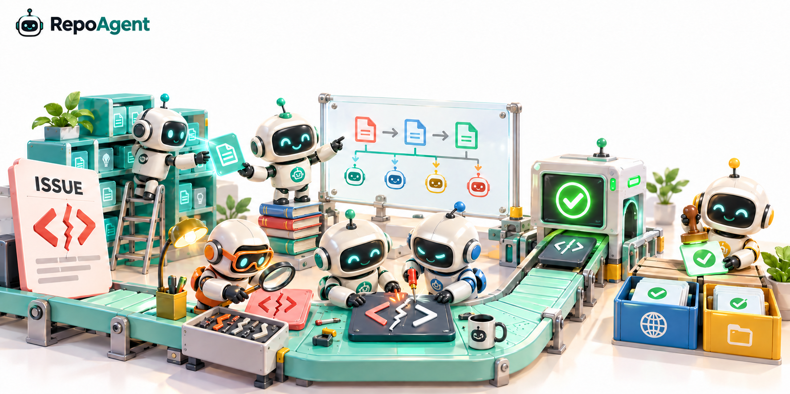
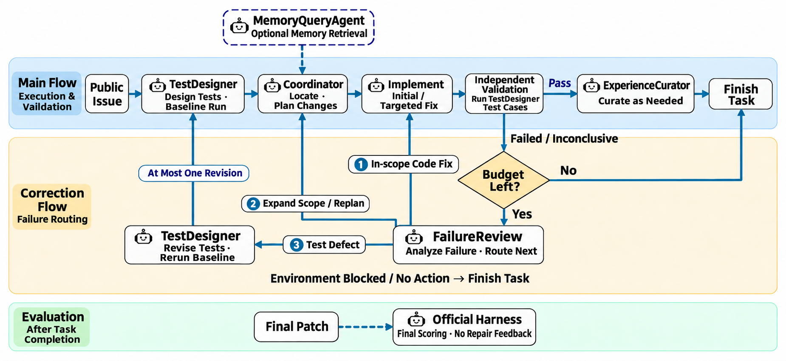
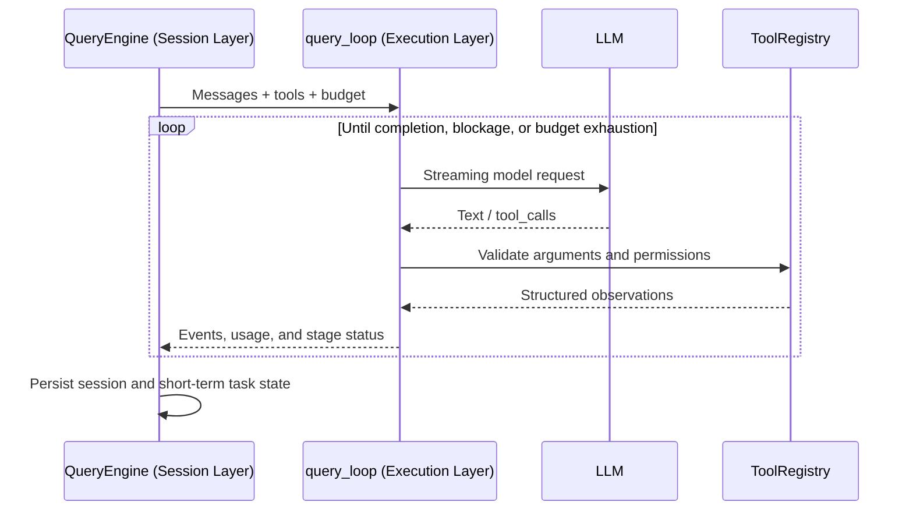
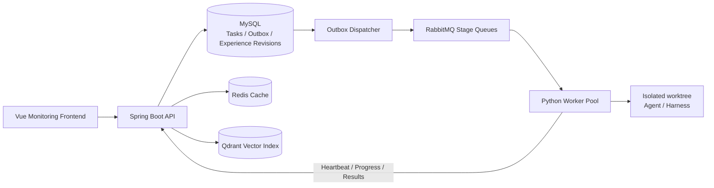

<div align="center">

# RepoAgent

[简体中文](README.zh-CN.md) | **English**



### Give an issue to a repair team with a role for every step.

**Experience Retrieval · Collaborative Diagnosis · Targeted Repair · Continuous Learning**

[Meet the Team](#meet-the-team) · [Repair Workflow](#repair-workflow) · [Memory and Retrieval](#memory-and-retrieval) · [Backend](#backend) · [Results](#swe-bench-lite-results) · [Quick Start](https://github.com/Artoriazzz/RepoAgent/blob/full-stack-integration/docs/quickstart.md)

</div>

---

RepoAgent is a multi-agent program repair platform for software repositories. It brings together public issues, source code, repair experience, and execution tools in a collaborative pipeline.

Each role has its own context and receives the information needed for its current stage: **the query agent finds reusable experience, the coordinator decides the repair direction, the implementer changes code, the failure analyst diagnoses unsuccessful attempts, and the curator distills knowledge from verified repairs.**

The platform includes a Python Agent Runtime, a Spring Boot backend, and a Vue monitoring frontend. The runtime uses the OpenAI-compatible `tools/tool_calls` protocol directly, implementing session management, tool execution, streaming responses, budget control, and role scheduling.

The complete platform is on the [full-stack-integration branch](https://github.com/Artoriazzz/RepoAgent/tree/full-stack-integration). The `main` branch contains the Python Agent Runtime, workers, and experiment tools.

## Why Multiple Agents

Program repair involves diagnosis, implementation, testing, failure analysis, and experience curation. RepoAgent assigns specialized roles to these stages so that context, model cost, and execution flow can be managed independently.

1. **Separate contexts**: Each role has its own session containing only the source, task, and upstream artifacts needed for its current stage. This reduces interference from unrelated history and helps control context length.
2. **Use lower-cost models for simpler work**: Query extraction and experience curation can use lower-cost models, while complex diagnosis and code repair can use more capable models. Models are selected per role through runtime configuration.
3. **Support pipelines and parallel scheduling**: Explicit handoffs make it easier for the backend to queue stages, apply rate limits, and allocate resources. Independent work or separate tasks can run concurrently, while dependent stages remain ordered. Actual concurrency depends on model limits and execution resources.
4. **Specialize stages and iterate independently**: Coordinator handles diagnosis and decisions, Implement changes code, TestDesigner designs tests, and FailureReview analyzes failures. Prompts, tools, budgets, and validation mechanisms can be adjusted per stage, with their effects checked across the workflow.
5. **Keep the repair flow controllable**: When one model handles every step, decisions about when to search, edit, validate, or stop can shift with its current reasoning. Explicit stages and routing let the program manage execution order, authorization scope, correction limits, and stopping conditions while models make decisions within their assigned responsibilities.

### Collaboration in Practice

| Common Challenge | RepoAgent's Approach |
| --- | --- |
| Reading a lot of code still leaves the edit location unclear | Coordinator investigates key unknowns and produces a behavior contract and an EditBrief |
| How can we tell whether a patch fixes the issue? | TestDesigner generates tests from the issue and source, then runs them against the original code to check bug-reproduction and regression scenarios |
| Removing an exception introduces regressions on valid inputs | Existing behavior to preserve is handed to the implementer, while TestDesigner designs regression tests for independent validation to check whether the repair affects previously valid behavior |
| Long failure logs lead to shifting correction strategies | FailureReview extracts concrete failures, invalidated assumptions, and actionable correction evidence |
| Similar problems require repeated investigation | Global and repository experience is retrieved for Coordinator to check against the current source |
| Concurrent repair tasks compete for resources or mix contexts | Stage queues schedule work, stateless runtimes reuse clients, and independent sessions isolate task state |

## Meet the Team

### Main Roles

| Role | Responsibility | Deliverables |
| --- | --- | --- |
| **MemoryQueryAgent: Experience Query** | Extracts the problem description and usage scenario from a public issue to form an independent retrieval query | `problem_description`, `usage_scenario` |
| **Coordinator: Diagnosis and Decisions** | Combines retrieved experience, the current issue, and source code to identify the faulty operation and decide the repair strategy and edit scope | Problem Contract, source evidence, EditBrief, authorized files and line ranges |
| **TestDesigner: Test Cases** | Designs tests from the public issue, source, and existing tests; runs them on the pre-repair baseline to check bug-reproduction and regression coverage | Internal test cases for checking repair results |
| **Implement: Code Changes** | Applies the EditBrief within the authorized scope and reports direct counterevidence and known risks | Initial patch, completion status, risk notes |
| **FailureReview: Failure Analysis** | Examines validation failures and authorized source code to identify semantic errors, missed paths, or environment failures | Evidence, invalidated assumptions, correction suggestions, scope adjustment needs |
| **ExperienceCurator: Experience Curation** | Abstracts knowledge after successful independent validation, checks for duplicates, and maintains existing experience | Global and repository experience, with add/merge/no-change decisions |

### Clear Responsibilities and Independent Judgment

Each agent has a defined task, along with tools and room to check its own reasoning. Conclusions from an earlier stage can still be examined, questioned, and revised by the next role.

- **TestDesigner: Write tests, then check the tests themselves.** It can run its generated cases against the unmodified code to see whether they reproduce the reported bug and whether the fixtures, setup, and assertions are sound. Cases that already pass and have a supported expectation can be retained to check that the repair preserves existing behavior.
- **Coordinator: Propose a repair, then try out the idea.** During diagnosis, it can run a small reproduction on the original code or temporarily try a candidate change to check whether the observations support its explanation. Once the cause is established, it hands Implement the edit location, repair direction, and behavior to preserve.
- **Implement: Work within scope and report what it discovers.** It chooses implementation details within the scope authorized by Coordinator. If it finds an omission, an affected neighboring branch, or an assumption contradicted by the source, it can report its findings, unfinished work, and known risks alongside the patch.
- **FailureReview: Identify what went wrong, then route it to the right role.** It examines logs, source, and prior deliverables. Faulty test setup or assertions go back to TestDesigner with evidence and revision suggestions. A broader edit scope or a new diagnosis goes to Coordinator. A sound plan that was implemented incorrectly goes to Implement for correction.

Every stage can check its ideas against actual results. When a problem is found, there is an explicit path for handing the evidence to the role that can address it.

## Repair Workflow

**TestDesigner prepares tests independently before any code changes.** It uses the public issue, unmodified source, and existing repository tests to design cases, runs them on the original baseline, and freezes usable tests. Test preparation is decoupled from Coordinator: initial test results are not injected into its context. Optional memory retrieval goes only to Coordinator to support diagnosis and decisions.

After Coordinator delivers an EditBrief, Implement produces the initial patch, and validation runs the frozen TestDesigner-generated cases. Failure or insufficient validation triggers a budget check: the task ends when the budget is exhausted; otherwise, FailureReview examines the result. It routes code defects within the authorized scope to Implement for targeted correction, broader scope or localization changes to Coordinator, and generated-test defects to TestDesigner with evidence and revision suggestions. Revised tests are run against the original baseline before checking the current patch again. Corrected code returns to the same independent validation stage.



Three handoffs keep responsibilities explicit:

1. **Experience → Decisions**: Retrieved knowledge enters Coordinator, which checks its applicability against the current issue and source code.
2. **Decisions → Implementation**: The EditBrief carries the target behavior, rationale, authorization scope, and existing behavior to preserve.
3. **Validation → Learning**: Successful repairs yield reusable experience. Similar knowledge is merged; entries remain unchanged when no useful knowledge is added.

## Memory and Retrieval

### Global and Repository Experience

| Type | Purpose | Stored Knowledge |
| --- | --- | --- |
| **Global experience** `global_experience` | Recognize similar failure mechanisms across repositories | Problem mechanisms, applicability conditions, general repair steps, validation approaches, and disproven approaches |
| **Repository experience** `repository_experience` | Locate the right implementation layer within the current repository | Stable modules/APIs, call relationships, reusable helpers, repository contracts, and public validation methods |

New experience follows **title → problem description → usage scenario → mechanism and applicability → repair steps → validation approach**. It preserves recognizable problem characteristics and reusable solutions. Before writing, ExperienceCurator retrieves related entries and chooses to add, merge, or leave them unchanged.

### Cosine-Similarity Retrieval

Both stored experience and incoming queries represent problems with `problem_description` and `usage_scenario`. The former summarizes the failure and expected behavior; the latter describes APIs, operations, input structures, and triggering conditions.

## Custom Agent Loop



- **Session layer**: Manages message history, short-term state, context compression, and storage of large tool outputs.
- **Execution layer**: Assembles streaming chunks and tool arguments, feeds observations back into the conversation, and handles stopping conditions and JSON output correction.
- **Tool layer**: Provides declarative schemas, role allowlists, file/line authorization, and read-consistency checks.
- **Scheduling layer**: Role runtimes reuse model connections; task sessions isolate workspaces, contexts, and tool state.

Application-level permissions control tool authorization, while container isolation protects the execution environment. See the [runtime architecture](docs/architecture.md) for details.

## Backend

Spring Boot manages users, repositories, issues, and task state. Python workers execute repair stages. The Vue frontend displays task queues, stage events, worker status, and validation results.



### An Asynchronous, Stage-Based Pipeline

Coordinator, Implement, validation, failure analysis, and experience curation are connected through separate stage queues. Each worker releases its role resources after finishing a stage; the next stage is consumed from its corresponding queue. Multiple tasks can therefore advance through different stages at the same time.

| Design | Purpose |
| --- | --- |
| **Stage queues + role pools** | Scale roles independently; the current configuration supports 1–3 instances per role |
| **Transactional Outbox** | Persists task state and outgoing events together, with publisher confirms and retries for message delivery |
| **Claims, leases, and heartbeats** | Establish execution ownership, detect offline workers, and reject late callbacks from expired leases |
| **Task-specific worktrees and stage snapshots** | Isolate code changes and use task state files for stage handoffs and execution recovery |
| **Cancellation, idempotency, and admission control** | Control duplicate execution, concurrency, user quotas, and system backlog |
| **Aggregated monitoring and event streams** | Track queues, running stages, worker activity, and validation results |

A single task follows its dependency order, while multiple tasks can use different role resources concurrently. See the [pipeline concurrency benchmark](docs/pipeline-concurrency-benchmark.md) for the scheduling benchmark methodology.

### Experience RAG with Versioning and Concurrent Updates

- **MySQL stores authoritative experience and revisions**: Retrievals and proposals reference specific versions so their supporting knowledge can be traced.
- **Qdrant retrieves vector candidates**: Scope filters narrow candidates, which are ranked using vector similarity and experience quality. Vector retrieval is enabled through configuration.
- **TTL jitter and short-lived rebuild locks**: Spread cache expiration times and reduce simultaneous cache-miss requests for hot entries.
- **Successful experience is merged through proposals**: Repair results produce observations and experience proposals; the maintenance workflow decides whether to add, update, or leave entries unchanged.
- **Version checks and index reconciliation**: Stale proposals are reconsidered against the current revision. Background jobs populate and reconcile the vector index.

See the designs for [experience RAG](https://github.com/Artoriazzz/RepoAgent/blob/full-stack-integration/backend/docs/memory-rag-design.md), [task admission and leases](https://github.com/Artoriazzz/RepoAgent/blob/full-stack-integration/backend/docs/repair-admission-quota-and-lease-design.md), and the [backend API](https://github.com/Artoriazzz/RepoAgent/blob/full-stack-integration/backend/README.md).

## SWE-bench Lite Results

Local development records on 300 SWE-bench Lite problems:

| Repair Setting | Resolved | Resolve Rate |
| --- | ---: | ---: |
| **Initial repair without experience** | 196 / 300 | **65.33%** |
| **Initial repair with experience** | 211 / 300 | **70.33%** |

## Explore the Code

Directory structure on the full-stack branch:

```text
repo_agent/                 Python Agent Runtime and workers
├── core/
│   ├── coordinator.py      Decisions, handoffs, and scheduling constraints
│   ├── subagent.py         Role definitions, prompts, and tool permissions
│   ├── query_engine.py     Session lifecycle and context
│   ├── query_loop.py       Model calls and tool execution loop
│   ├── memory_query.py     Independent query extraction
│   └── runtime_pool.py     Stateless role pools
├── tools/                  Declarative tools and repository operations
└── worker/                 Stage consumers, backend callbacks, evaluation, and experience proposals
backend/                    Spring Boot backend
└── frontend/               Vue monitoring frontend
scripts/                    Batch runners, vector experiments, and environment tools
tests/                      Python unit and offline integration tests
```

- [Quick Start](https://github.com/Artoriazzz/RepoAgent/blob/full-stack-integration/docs/quickstart.md) · [WSL Deployment and Development](https://github.com/Artoriazzz/RepoAgent/blob/full-stack-integration/docs/full-stack-development.md)
- [Coordinator Prompt](docs/prompts/Coordinator.md) · [Implement Prompt](docs/prompts/Implement.md)
- [FailureReview Prompt](docs/prompts/FailureReview.md) · [ExperienceCurator Prompt](docs/prompts/ExperienceCurator.md)

## License

[MIT](LICENSE)
