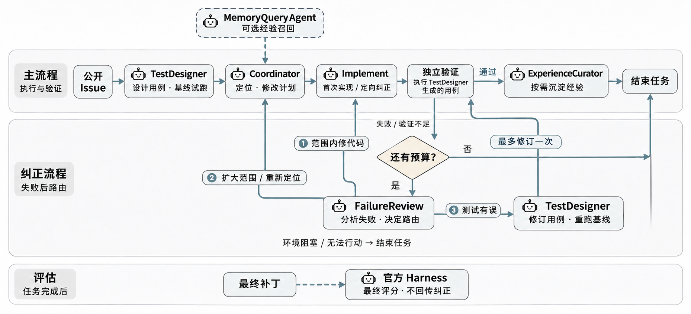
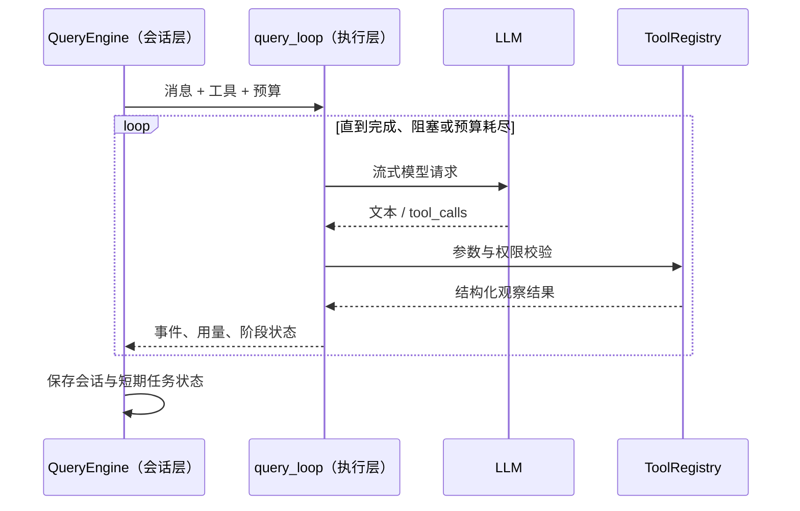
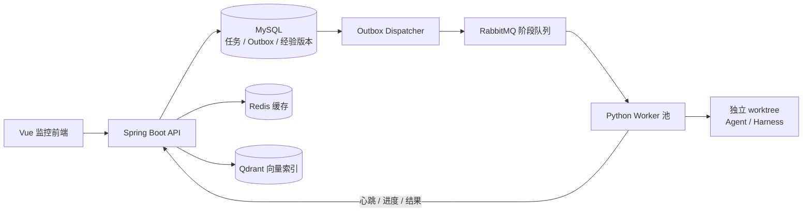

<div align="center">

# RepoAgent

**简体中文** | [English](README.en.md)


### 把一个 Issue，交给一支各司其职的修复小队。

**经验召回 · 协同定位 · 定向修复 · 持续学习**

[认识修复小队](#认识修复小队) · [运行流程](#运行流程) · [经验与检索](#经验与检索) · [后端介绍](#后端介绍) · [实验结果](#swe-bench-lite-实验结果) · [快速开始](https://github.com/Artoriazzz/RepoAgent/blob/full-stack-integration/docs/quickstart.md)

</div>

---

RepoAgent 是面向软件仓库的多 Agent 程序修复平台，将公开 Issue、源码、修复经验与执行工具组织成一条协作流水线。

每个角色拥有独立上下文，只接收当前阶段需要的信息：**查询者寻找可复用经验，协调者决定修复方向，实现者落实代码修改，归因者分析失败，经验整理者沉淀验证成功的知识。**

平台包含 Python Agent Runtime、Spring Boot 业务后端和 Vue 监控前端。Agent Runtime 直接使用 OpenAI-compatible `tools/tool_calls` 协议，实现会话管理、工具执行、流式响应、预算控制与角色调度。

完整平台源码位于 [full-stack-integration 分支](https://github.com/Artoriazzz/RepoAgent/tree/full-stack-integration)；`main` 分支保留 Python Agent Runtime、Worker 与实验工具。

## 为什么是多 Agent

| 常见困境 | RepoAgent 的做法 |
| --- | --- |
| 查阅大量代码后，仍难以决定修改位置 | Coordinator 围绕关键未知读取源码，形成行为契约与 EditBrief |
| 异常消失了，相邻合法路径却出现回归 | 将需要保持的旧行为交接给实现者，并由独立验证检查目标行为与回归 |
| 失败日志很长，纠正方向反复变化 | FailureReview 提取失败事实、失效假设和可执行的修正依据 |
| 相似问题每次都要重新摸索 | 检索历史全局经验与仓库经验，供 Coordinator 结合当前源码复核 |
| 多个修复任务争抢资源、混用上下文 | 阶段队列调度任务，无状态 Runtime 复用客户端，独立 Session 隔离任务状态 |

## 认识修复小队

**本版新增：[公开测试 Agent](docs/public-validation.md)**。它根据公开 Issue、源码与已有测试独立设计用例，先跑原始基线，再用同一组冻结用例验证补丁。可信失败可触发纠正；官方 Harness 在这条路径上只做最终评分。目前已接入 CLI 和 SWE-bench 批处理，后端阶段队列尚未接入。

### 主线角色

| 角色 | 职责 | 交付物 |
| --- | --- | --- |
| **MemoryQueryAgent：经验查询** | 从公开 Issue 提取问题描述与使用场景，形成独立的检索查询 | `problem_description`、`usage_scenario` |
| **TestDesigner：公开测试** | 根据公开 Issue、修改前源码和已有测试独立设计用例，先试跑基线；收到失败归因后可修订有问题的用例 | 测试计划、冻结用例、基线与修复后结果 |
| **Coordinator：定位与决策** | 结合召回经验、当前题意和源码，确认错误操作，决定修复方案与编辑范围 | Problem Contract、源码证据、EditBrief、授权文件与行范围 |
| **Initial Implement：首次实现** | 按照 EditBrief 在授权范围内完成修改，报告直接反证与已知风险 | 初始 patch、完成状态、风险说明 |
| **FailureReview：失败归因** | 分析验证失败事实和允许读取的源码，识别语义错误、遗漏路径或环境故障 | 证据清单、失效假设、纠正建议、范围调整需求 |
| **Corrective Implement：纠正实现** | 根据归因结果和当前授权，对已有 patch 进行定向修正 | 纠正 patch、修改说明、剩余风险 |
| **ExperienceCurator：经验整理** | 在独立验证成功后抽象知识，查重并维护已有经验 | 全局经验、仓库经验及新增/合并/不保存决策 |


## 运行流程

**TestDesigner 先独立准备测试，再开始修改代码。** 它根据公开 Issue、修改前源码和仓库已有测试设计用例，在原始基线上试跑后冻结可用测试。测试准备与 Coordinator 解耦，初始测试结果不注入 Coordinator；可选的经验召回只进入 Coordinator，帮助定位与决策。

Coordinator 交付 EditBrief 后，由 Implement 完成首次修复，再执行冻结的 TestDesigner 生成用例。失败或验证不足时检查剩余预算：耗尽则结束，否则交给 FailureReview。归因后有三条路：授权范围内的代码问题交给 Implement 定向纠正；需要扩展范围或重新定位时回到 Coordinator；生成测试有问题时，把失败证据和建议交给 TestDesigner 修订并重新试跑基线，再验证当前补丁。纠正后的代码都回到同一个独立验证环节。



图中展示TestDesigner 生成用例驱动的协作流程。测试修订会记录新版本与基线结果，正常代码纠正复用冻结用例；验证不足不会被当作修复成功。经验召回、经验生成与纠正次数由运行配置控制；官方 Harness 仅作最终评分，不向该流程提供纠正反馈。CLI 与 SWE-bench 批处理已接入，后端阶段队列对 TestDesigner 的接入仍待完成。具体入口与预算见 [运行说明](https://github.com/Artoriazzz/RepoAgent/blob/full-stack-integration/docs/quickstart.md#运行流程与入口)。

整个过程中保留三个明确的交接点：

1. **经验 → 决策**：召回内容进入 Coordinator，由当前题意与源码确认适用性。
2. **决策 → 实现**：EditBrief 同时交付目标行为、修改依据、授权范围和需要保持的旧行为。
3. **验证 → 学习**：验证成功后提炼经验；已有同类知识时优先合并，有效知识没有增加时保持原样。

## 经验与检索

### 全局经验与仓库经验

| 类型 | 面向的问题 | 保存内容 |
| --- | --- | --- |
| **全局经验** `global_experience` | 在其他仓库识别同类机制 | 问题机制、适用条件、通用修复步骤、验证思路、已证伪做法 |
| **仓库经验** `repository_experience` | 在当前仓库快速找到正确实现层 | 稳定模块/API、调用关系、可复用辅助函数、仓库契约、公开验证方法 |

新经验按“**标题 → 问题描述 → 使用场景 → 机制与适用条件 → 修复步骤 → 验证思路**”组织，保留问题的识别特征与可复用解法。ExperienceCurator 在写入前检索相关项，选择新增、合并或保持原样。

### 基于余弦相似度检索过程

历史侧和查询侧均以 `problem_description`、`usage_scenario` 表达问题：前者概括异常与预期行为，后者描述 API、操作、输入结构和触发条件。


## 自研 Agent Loop



- **会话层**：管理消息历史、短期状态、上下文压缩和工具大结果落盘。
- **执行层**：拼接流式分片与工具参数，回填观察结果，处理停止条件与 JSON 输出修正。
- **工具层**：使用声明式 schema、角色白名单、文件/行范围授权和读取一致性检查。
- **调度层**：角色 Runtime 复用模型连接，任务 Session 隔离工作区、上下文与工具状态。

应用层权限控制与容器隔离分别承担工具授权和执行环境保护。架构细节见 [运行时说明](docs/architecture.md)。

## 后端介绍

Spring Boot 管理用户、仓库、Issue 和任务状态；Python Worker 执行修复阶段；Vue 前端展示任务队列、阶段事件、Worker 状态和验证结果。



### 按阶段推进的异步流水线

Coordinator、Implement、验证、失败归因和经验整理通过独立阶段队列衔接。每个 Worker 完成当前阶段后释放角色资源，下一阶段由对应队列继续消费，让多个任务在不同阶段重叠推进。

| 设计 | 作用 |
| --- | --- |
| **阶段队列 + 角色池** | 各角色独立扩容，当前配置支持每角色 1–3 个实例 |
| **事务 Outbox** | 将任务状态与待投递事件一起持久化，通过发布确认和重试推进消息投递 |
| **claim、租约与心跳** | 确认执行归属，识别离线 Worker，拒绝过期租约的迟到回调 |
| **任务专属 worktree 与阶段快照** | 隔离代码修改，以任务状态文件衔接阶段与恢复执行 |
| **取消、幂等与准入控制** | 控制重复执行、并发数量、用户配额与系统积压 |
| **监控聚合与事件流** | 查看排队、运行阶段、Worker 活跃情况与验证结果 |

单个任务按依赖关系推进，多任务可以并行占用不同角色的资源。调度基准方法见 [流水线并发实验](docs/pipeline-concurrency-benchmark.md)。

### 面向版本与并发更新的经验 RAG

- **MySQL 保存正式经验与 revision**：召回和提案绑定具体版本，支持追溯经验依据。
- **Qdrant 承担向量候选检索**：按作用域过滤候选，结合向量相似度与经验质量进行排序；通过配置启用。
- **TTL 抖动与短租约重建锁**：分散缓存失效时间，收敛热点回源请求。
- **成功经验通过提案合并**：修复结果生成 observation 和经验提案，由经验维护流程执行新增、更新或不变决策。
- **版本检查与索引对账**：过期提案重新基于当前版本判断；向量索引通过后台任务补齐和对账。

完整设计见 [经验 RAG](https://github.com/Artoriazzz/RepoAgent/blob/full-stack-integration/backend/docs/memory-rag-design.md)、[任务准入与租约](https://github.com/Artoriazzz/RepoAgent/blob/full-stack-integration/backend/docs/repair-admission-quota-and-lease-design.md) 和 [后端接口](https://github.com/Artoriazzz/RepoAgent/blob/full-stack-integration/backend/README.md)。

## SWE-bench Lite 实验结果

在 300 道 SWE-bench Lite 题目上的本地研发记录：

| 修复设置 | 通过题数 | 通过率 |
| --- | ---: | ---: |
| **无经验首轮修复** | 156 / 300 | **52.00%** |
| **经验召回首轮修复** | 211 / 300 | **70.33%** |
| **失败反馈纠正后** | 227 / 300 | **75.67%** |

包含经验检索的首轮汇总较原首轮提高 **18.33 个百分点**。针对历史首轮失败、纠正成功的 71 题，检索召回后有 **55 题在新的首轮修复中通过**，体现了经验复用对已学问题的帮助。


## 深入代码

全栈分支的目录结构：

```text
repo_agent/                 Python Agent Runtime 与 Worker
├── core/
│   ├── coordinator.py      决策、交接与调度约束
│   ├── subagent.py         角色定义、Prompt、工具权限
│   ├── query_engine.py     会话生命周期与上下文
│   ├── query_loop.py       模型调用与工具执行循环
│   ├── memory_query.py     独立查询提取
│   └── runtime_pool.py     无状态角色池
├── tools/                  声明式工具与仓库操作
└── worker/                 阶段消费、后端回调、评测与经验提案
backend/                    Spring Boot 业务后端
└── frontend/               Vue 监控前端
scripts/                    批处理、向量实验和环境工具
tests/                      Python 单元与离线集成测试
```

- [快速开始](https://github.com/Artoriazzz/RepoAgent/blob/full-stack-integration/docs/quickstart.md) · [WSL 部署与开发](https://github.com/Artoriazzz/RepoAgent/blob/full-stack-integration/docs/full-stack-development.md)
- [Coordinator Prompt](docs/prompts/Coordinator.md) · [Implement Prompt](docs/prompts/Implement.md)
- [FailureReview Prompt](docs/prompts/FailureReview.md) · [ExperienceCurator Prompt](docs/prompts/ExperienceCurator.md)

## License

[MIT](LICENSE)
