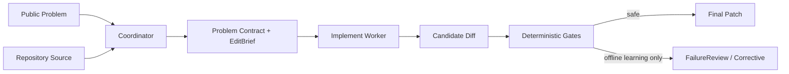
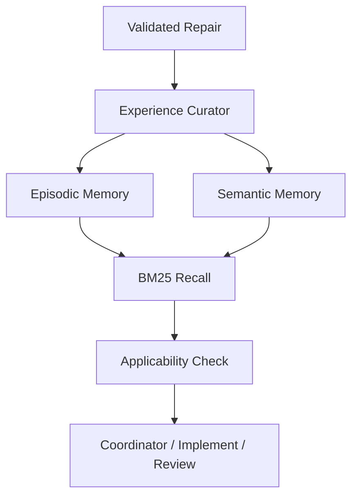

# RepoAgent 架构说明

本文聚焦 RepoAgent 的运行时边界、Agent 协作方式和关键设计取舍。SWE-bench 的实验数字与提交口径见 [技术报告](swebench-lite-technical-report.md)。

## 1. 设计目标

RepoAgent 需要在一个真实代码仓库中完成四件事：

1. 从公开问题描述中提取可执行的软件行为契约。
2. 用尽量少的仓库读取定位契约所有者和修改范围。
3. 在受限权限内生成可评测的最小 patch。
4. 保存完整证据链，使失败能够归因到定位、实现、验证或环境阶段。

系统直接使用 Chat Completions function calling 协议。这样可以显式控制消息历史、工具暴露、循环终止、上下文压缩和 token 统计，而不是把这些行为交给框架默认实现。

## 2. 运行时分层

```mermaid
sequenceDiagram
    participant User
    participant Engine as QueryEngine
    participant Loop as query_loop
    participant LLM
    participant Registry as ToolRegistry
    participant Tool

    User->>Engine: task
    Engine->>Loop: messages + tools + step budget
    loop until finish or budget exhausted
        Loop->>LLM: messages + tool schemas
        LLM-->>Loop: content / tool_calls
        Loop->>Registry: execute(name, arguments)
        Registry->>Registry: permission + schema validation
        Registry->>Tool: invoke
        Tool-->>Registry: ToolResponse
        Registry-->>Loop: structured observation
        Loop->>Loop: append assistant/tool messages
    end
    Loop-->>Engine: LoopEvent stream
    Engine-->>User: answer + artifacts
```

### QueryEngine

会话级运行时，负责：

- 构造 system prompt 和动态仓库上下文。
- 保存 messages、trace 和 token usage。
- 更新 ShortTermMemory。
- 在上下文压力上升时持久化大结果、裁剪旧 observation 并生成摘要。
- 接收 abort 信号并保存中间状态。

### query_loop

单轮执行器，负责：

- 调用支持 function calling 的 LLM。
- 解析并执行模型返回的 tool calls。
- 将结构化工具结果写回消息历史。
- 处理 `finish`、无工具响应、最大步数和 JSON completion guard。
- 通过 `LoopEvent` 暴露每一步状态，而不绑定 CLI 或 UI。

## 3. Coordinator 模式



Coordinator 不直接承担全部代码修改。它先形成 `RepairBrief`：

- 触发问题的输入。
- 精确期望行为。
- 必须保持的旧行为。
- 当前源码提供的证据。
- 允许修改的文件和行范围。

Implement Worker 获得独立的 QueryEngine 和精简工具集。它不能全仓搜索、读取 git 历史或执行任意命令，只能在 `allowed_files/allowed_ranges` 内读取和替换代码。该限制将“定位是否正确”和“实现是否正确”拆成可独立分析的阶段。

Worker 角色包括 Research、Implement、PatchReview、Verify、FailureReview、Corrective Implement 和 Experience Curator。默认 SWE-bench 路径只启用必要角色，避免同源模型重复分析造成上下文污染。

## 4. 工具系统

工具定义由四部分构成：

- 名称、描述和 JSON 参数 schema。
- 实际执行函数。
- permission predicate。
- 可选的工具级 prompt 规则。

`ToolRegistry` 在调用前完成参数类型校验和权限检查，在调用后统一截断结果。执行异常被转换为 `ToolResponse(status="error")`，因此单个工具失败不会直接打断整个 Agent Loop。

仓库写工具额外维护文件读取时间戳，防止 Agent 在旧内容上覆盖外部修改。Coordinator 模式还会校验 Implement 的文件范围、行范围、测试文件禁写和 patch 静态策略。

## 5. 双层记忆



Episodic Memory 保存具体但紧凑的 demonstration，Semantic Memory 保存跨任务抽象原则。保存前会检查相似条目，优先合并而不是重复新增。召回后还要经过 applicability check；历史经验只提供软参考，当前仓库源码始终是最终依据。

正式 benchmark 使用冻结记忆快照，禁止在线写回。experience-build 才允许在最终验证成功后更新记忆。

## 6. 两种状态机

### Benchmark

```text
公开题意与源码
  -> Coordinator 定位
  -> Scoped Implement
  -> 确定性静态检查
  -> 单个最终 patch
  -> 外部 harness 评测
```

该模式不把评测失败反馈给 Agent，保持 pass@1 口径。

### Experience Build

```text
初始 patch
  -> 独立 harness
  -> unresolved 且非环境错误
  -> FailureReview
  -> 最多一次 Corrective Implement
  -> 最终 harness
  -> resolved 后 Experience Curator
```

FailureReview 只消费压缩后的失败证据，纠正范围限制在初始 patch 附近。环境错误和证据不足不会触发盲目纠正。

## 7. 可观测性与失败归因

每个主 Agent 和 Worker 都保存独立 trace。批处理将推理记录与 harness 结果合并为阶段归因：

- `implementation_delivery`：没有留下可评测 patch。
- `deterministic_validation`：语法、范围或静态策略失败。
- `semantic_fix_incomplete`：目标行为仍失败。
- `public_regression`：目标行为通过，但旧行为回归。
- `semantic_fix_and_regression`：修复和回归同时失败。
- `harness_environment`：Docker、网络或依赖环境错误。

该结构既用于调试，也用于判断应该改进 Coordinator、Implement、Review，还是评测基础设施。

## 8. 主要取舍

- **显式状态优于隐藏编排**：状态和边界都落在普通 Python 对象与 JSON 产物中。
- **限制修改面优于无限自治**：代码 Agent 最危险的失败通常不是不会写，而是在错误契约层做了合理但无关的修改。
- **确定性检查优于增加同源 Reviewer**：语法、范围、测试文件和危险命令由代码检查；LLM 只处理语义判断。
- **离线学习与正式评测分离**：允许研究失败反馈，但不让它改变正式 pass@1 的定义。
- **记忆是先验，不是答案**：召回结果必须通过当前源码证据重新确认。
