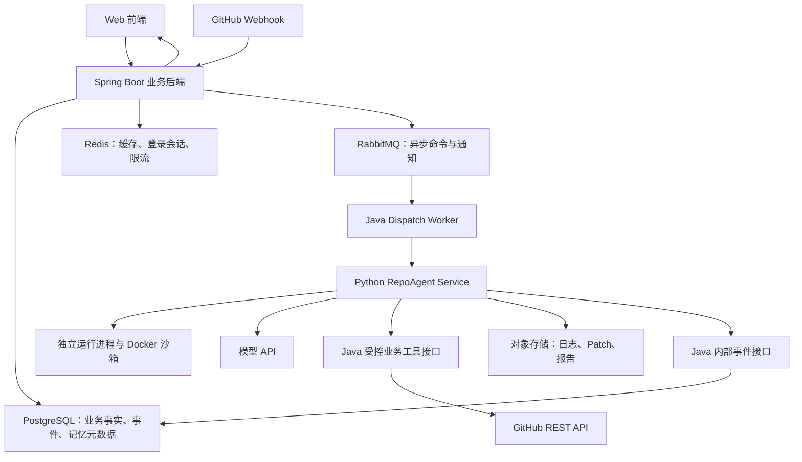
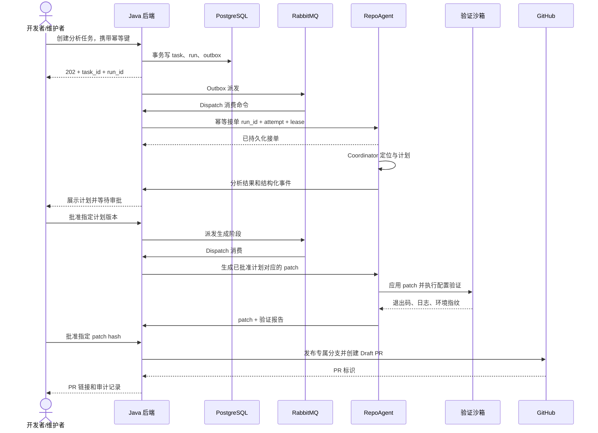

# 智能代码缺陷修复平台：业务与后端技术设计

版本：设计草案 v1.0
日期：2026-09-09
定位：Java / Spring Boot 业务后端 + 独立 Python RepoAgent 修复服务
说明：本文描述待建设的平台，涉及接口、表结构和服务化能力均为设计，不代表已完成实现。

阅读导航：

- 业务定位：[目标](#1-产品定位与建设目标)、[用户和场景](#2-用户角色与应用场景)、[功能](#5-功能清单与页面设计)、[流程](#6-完整业务流程)。
- 开发设计：[现有能力](#3-现有-repoagent-与新增能力)、[技术栈](#4-总体架构与技术栈)、[状态](#7-状态模型业务执行验证与发布分开)、[数据模型](#8-数据模型与索引)、[接口](#9-java-与-repoagent-的接口协议)。
- 可靠性：[任务队列](#10-消息队列与长任务可靠性)、[并发问题](#11-关键并发问题及后端解决方案)、[缓存](#12-缓存设计与数据库优化)、[工具](#13-工具封装业务授权与-mcp)、[记忆](#14-会话短期记忆与长期记忆)。
- 交付运维：[验证恢复](#15-验证可信度与失败恢复)、[资源优化](#16-资源与性能优化)、[安全](#17-安全与真实业务边界)、[验收](#18-可观测性运维与验收)、[实施顺序](#19-实施顺序与交付物)。

## 1. 产品定位与建设目标

平台面向维护 GitHub 仓库的研发团队，将缺陷接入、问题分析、补丁生成、验证、人工审核和 PR 发布串成一条可追踪的业务流程。RepoAgent 是平台内部的智能修复组件，业务后端负责决定谁可以发起任务、任务何时执行、结果如何审核与发布。

一句话定义：**把 GitHub Issue 转换为有依据、可验证、可审核的代码补丁，并管理其完整交付过程。**

### 1.1 要解决的问题

| 现有痛点 | 平台提供的能力 | 可观察结果 |
|---|---|---|
| Issue 分散，需求信息不完整 | 同步、补充信息、缺陷版本快照 | 可追溯的任务输入 |
| 定位问题依赖人工反复阅读代码 | RepoAgent 定位并形成修复计划 | 根因假设、证据和影响范围 |
| 代码生成后难以判断是否可靠 | 隔离验证、基线比较、报告归档 | 通过、失败、未验证、环境错误分开展示 |
| 多人重复处理同一缺陷 | 指派、幂等提交、活动任务互斥 | 避免重复费用和重复 PR |
| 修复过程不可见、难以中止 | 阶段事件、日志、取消、预算控制 | 用户知道任务在做什么及成本 |
| 成功经验不能复用 | 经审核的双层记忆和版本管理 | 可解释的经验召回记录 |

### 1.2 首版边界

- 支持 GitHub 仓库，首批验证环境聚焦现有 RepoAgent 擅长的 Python 项目。业务后端使用 Java，不代表首版自动支持所有 Java 仓库修复。
- 支持 Issue 同步、人工创建缺陷、分析、修复、验证、审核和 Draft PR。
- 默认由人批准发布；不自动合并 PR，不直接修改主分支。
- CI 日志可作为缺陷附件，完整 CI 自动修复作为后续入口扩展。
- 复用 RepoAgent，先提供一个模块化 Java 单体和一个独立 Agent 服务，不按业务表拆微服务。
- 不承诺自动修复所有缺陷。证据不足、环境不支持和修复失败均为合法业务结果。

## 2. 用户角色与应用场景

### 2.1 角色

| 角色 | 主要权限 |
|---|---|
| 组织管理员 | 管理组织成员、GitHub 安装绑定、额度和仓库策略 |
| 项目维护者 | 指派缺陷、配置验证模板、发起任务、审核补丁、发布 PR |
| 开发者 | 提交缺陷、补充需求、发起被授权的分析与修复、查看结果 |
| 观察者 | 查看授权项目和脱敏报告，不发起写操作 |
| 平台运维 | 管理 Worker 和故障处理；不因运维角色自动获得私有源码访问权 |
| 服务身份 | 按任务获得短期授权，只执行指定仓库、指定运行的操作 |

权限由“组织成员资格 + 项目角色 + 仓库授权 + 当前操作策略”共同决定。GitHub 安装权限是外部上限，平台内部授权不能扩大该上限。

### 2.2 场景 A：维护者处理新缺陷

维护者接入仓库，将一个已确认的 GitHub Issue 同步到平台，补充复现方式，然后点击“分析”。平台展示问题理解、疑似根因、涉及文件和修复计划。维护者批准后生成补丁，验证通过后检查 Diff 并发布 Draft PR。

价值：把人工时间集中到确认需求和审查结果。分析与发布之间保留明确的人类决策点。

### 2.3 场景 B：开发者提交信息不完整的问题

开发者只提供“某种输入触发错误”和日志。RepoAgent 分析后发现缺少版本或输入样例，返回 `NEEDS_INFORMATION`。前端展示待回答问题，用户在同一会话补充信息，平台创建新的输入快照再分析。

价值：避免在事实不足时反复生成猜测性 patch。用户追加内容不会无声地改变正在执行任务的输入。

### 2.4 场景 C：团队并行处理积压缺陷

维护者选择多个已确认 Issue 批量提交。后端按租户配额、Worker 资源和模型额度调度。每个任务使用独立提交快照和工作区；相同缺陷的重复提交被合并或拒绝。成功的补丁分别审核，不因批量提交自动批准。

价值：把当前依赖脚本、SSH 和手工检查日志的工作转成可管理的后台任务。

### 2.5 场景 D：历史修复经验积累

维护者对允许学习的历史任务启动 `experience-build`。系统执行初次修复、验证、有限纠正，成功后形成记忆候选。维护者审核后发布记忆版本，未来任务按策略检索。

价值：将成功经验转成带来源、适用条件和版本的知识资产。普通业务反馈和 SWE-bench 学习数据必须标明来源。

## 3. 现有 RepoAgent 与新增能力

### 3.1 可复用的现有代码

| 现有位置 | 已有职责 | 服务化复用方式 |
|---|---|---|
| `repo_agent/core/query_engine.py` | 会话消息、摘要、事件处理、产物保存、取消信号 | 每个运行独立实例，增加事件输出适配器 |
| `repo_agent/core/query_loop.py` | LLM 与工具调用循环 | 保留循环，由外层传入取消和预算 |
| `repo_agent/core/coordinator.py` | 定位、计划、Worker 编排 | 作为修复引擎，不接管业务审批 |
| `repo_agent/core/subagent.py` | 子 Agent 上下文与权限 | 保留角色隔离和编辑范围 |
| `repo_agent/core/tool.py`、`tools/catalog.py` | 工具定义与注册 | 接入后端授权的工具适配器 |
| `repo_agent/core/experience.py` | 模式策略、失败反馈、经验提炼 | 封装学习任务入口，保持模式隔离 |
| `core/memory.py`、`core/session_memory.py` | 长短期记忆 | 经存储接口逐步接入平台，不直接替换全部实现 |
| `tools/github_tools.py` | Issue、仓库信息和 Actions 日志读取 | 可改由后端 GitHub 适配器代理 |

当前 GitHub 工具主要是读取能力，不能把分支创建、审批发布和 PR 幂等控制当成已实现功能。CLI 中的配置装配和学习流程也需要提取为服务可调用的应用接口。

### 3.2 需要新增

- Java 业务模块、数据库、鉴权、Webhook、审批、PR 发布和审计。
- Python Agent 服务入口、持久化接单、运行隔离、事件上报、心跳和终止管理。
- 运行专属目录，替代并发任务共用 `.repo_agent_runs/latest` 的方式。
- 统一输入、输出和事件协议，区分运行结果与模型自然语言。
- 任务租约、恢复策略和外部操作对账。
- 可配置、由维护者批准的仓库验证环境模板。

## 4. 总体架构与技术栈

### 4.1 部署结构



Dispatch Worker 首版与业务后端同一代码工程、可同进程部署；增长后用独立 profile 部署。Agent 进程和验证沙箱部署到计算节点，与数据库、消息队列分开。

### 4.2 推荐技术栈

| 层次 | 选择 | 原因与承担的职责 |
|---|---|---|
| Java | Java 21 LTS | 统一语言基线，成熟工具链 |
| Web 后端 | Spring Boot 4.1.x、Spring MVC | REST API、业务事务、SSE；依赖使用 Boot BOM 管理 |
| 构建 | Maven Wrapper | 固定构建版本和依赖，保证环境可复现 |
| 鉴权 | Spring Security、OAuth2 Client、Spring Session | GitHub 用户登录、服务端登录会话、方法级授权 |
| 数据访问 | Spring JDBC / JdbcClient | 关键条件更新、租约和 Outbox SQL 清晰可控 |
| 数据库 | PostgreSQL 17 系列 | 事务、约束、JSONB、行锁、全文检索 |
| 数据迁移 | Flyway | 可版本化建表、索引和升级脚本 |
| 缓存 | Redis | 元数据缓存、Session、限流；不作为任务事实库 |
| 消息队列 | RabbitMQ 4.x + Spring AMQP | 修复派发、发布命令、异步通知、重试和死信 |
| Agent 服务 | Python 3.11 + FastAPI + 现有 RepoAgent | 服务接入与实际 Agent 执行，沿用现有工具循环 |
| Agent 接单日志 | 持久卷上的 SQLite WAL（单节点首版） | 在返回接单成功前落盘；仅是节点执行日志，非业务事实库 |
| 记忆检索 | 现有关键词检索，后续 PostgreSQL + pgvector | 先沿用可用能力，再增加向量与关键词混合召回 |
| 对象存储 | S3 兼容对象存储 | 保存大日志、patch、报告，提供短时下载地址 |
| 隔离环境 | Docker + 专用执行节点 | 按运行限制 CPU、内存、进程数和网络 |
| 可观测性 | Actuator、Micrometer、OpenTelemetry、Prometheus/Grafana | 指标、链路和告警；本地可按需启动 |
| 前端建议 | Vue 3 + TypeScript + Element Plus | 缺陷列表、Diff、任务时间线、审核和管理界面 |
| 测试 | Spring Boot Test、JUnit、Testcontainers | 验证真实 PostgreSQL/RabbitMQ/Redis 下的并发语义 |
| 部署 | Docker Compose 起步 | 首版不要求 Kubernetes、注册中心或服务网格 |

Spring Boot 官方当前系统要求覆盖 Java 21；具体补丁版本与第三方依赖在落地时锁定并做集成验证，不使用浮动 `latest`。[Spring Boot 系统要求](https://docs.spring.io/spring-boot/system-requirements.html)

选择 RabbitMQ 是因为本业务主要是有限任务派发和通知，不需要首版同时引入 Kafka。选择 PostgreSQL 是为了让业务事务与后续向量检索共用一种数据库。Java 不再引入第二套 Agent 编排；RepoAgent 继续持有 LLM、上下文和工具循环。

### 4.3 Java 模块划分

```text
platform-backend/
  identity/       登录、组织、成员和项目权限
  repository/     仓库绑定、提交快照和验证配置
  issue/          缺陷、指派、评论和输入版本
  repair/         任务、运行、状态、取消和预算
  agentbridge/    RepoAgent 协议适配、派发、心跳和事件
  validation/     验证计划、执行记录和结果判定
  approval/       修复计划与补丁审批
  publication/    分支推送、Draft PR 和对账
  memory/         记忆来源、版本、审核和检索授权
  integration/    GitHub App、Webhook 和业务工具
  infrastructure/ 数据库、Outbox、缓存、存储和观测
```

模块通过应用服务调用。Controller 只负责参数和身份入口，事务与状态转换放在应用服务，工具执行不能绕过相同业务规则。

## 5. 功能清单与页面设计

| 模块 | 首版功能 | 后续增强 |
|---|---|---|
| 用户与组织 | 登录、成员、角色、项目权限 | 企业身份源、精细配额 |
| 仓库管理 | GitHub App 安装绑定、仓库接入、默认分支、验证模板 | 多代码托管平台 |
| 缺陷管理 | 导入 Issue、人工创建、指派、优先级、评论、附件、状态筛选 | 批量分类与重复问题建议 |
| 智能分析 | 输入快照、代码定位、修复计划、缺失信息提示 | 计划对比 |
| 自动修复 | 受限编辑、patch 归档、无效补丁识别 | 经配置的公开失败纠正 |
| 验证 | 基线与补丁测试、环境错误区分、证据展示 | 多环境矩阵 |
| 审核发布 | 查看 Diff、批准/驳回、Draft PR、状态同步 | 多人审批、自动低风险发布策略 |
| 运行管理 | 队列、阶段、日志、Token、取消、显式重试 | 批量任务、资源画像调度 |
| 记忆管理 | 沿用已有检索、固定记忆版本、来源展示 | 向量检索、经验审核与合并 |
| 运维管理 | Worker 心跳、超时任务、死信、Webhook 重放 | 容量预测和分级告警 |

主要页面：项目总览、仓库配置、缺陷列表、缺陷详情、任务详情、补丁审核、PR 记录、记忆库、运行管理。任务详情展示阶段事实、证据引用和工具摘要；默认不展示模型内部 reasoning_content。

### 5.1 核心业务规则

1. 一次运行固定 Issue 版本、代码提交、验证模板、模型角色配置、Prompt 版本和记忆快照。
2. 分析审批和补丁审批是不同对象；前者允许生成代码，后者允许向 GitHub 发布特定产物。
3. 初始配置可以将分析与生成合并为一次任务，保留最终发布审批，避免所有低风险任务都等待两次人工操作。
4. 验证通过只代表配置的检查通过，不等同于缺陷彻底解决。GitHub PR 合并和 Issue 关闭分别同步记录。
5. `EMPTY_PATCH`、`INVALID_PATCH`、`TEST_FAILED`、`ENVIRONMENT_ERROR` 和 `UNVERIFIED` 分别展示。
6. Agent 生成的自信程度、文字“已修复”不能驱动通过状态。
7. 人工重试会创建新 `run_id`，记录原因和父运行，不覆盖旧结果。

## 6. 完整业务流程

### 6.1 仓库接入

1. 用户登录平台并创建项目。
2. 管理员安装 GitHub App，授权选定仓库。
3. 后端校验安装归属，记录 installation 与项目绑定。
4. 同步仓库元数据和 Issue；OAuth 登录凭据与 GitHub App 仓库凭据分开管理。
5. 维护者配置允许编辑的范围、禁止文件、验证镜像、测试命令和资源上限。
6. 执行环境预检，通过后允许发起修复；预检失败可继续只读分析。

### 6.2 Issue 到 Draft PR



分析完成后释放沙箱，不让容器等待几小时的人类审批。实施阶段从固定提交恢复工作区，读取已批准计划，重新校验引用文件与 hash；计划失效则要求重新分析。现有 Coordinator 需要新增“输出计划后停止”和“从已批准计划实施”的薄适配入口。

### 6.3 补充信息与驳回

- `NEEDS_INFORMATION`：保存缺失项并结束本次分析运行，用户补充后创建新输入版本。
- 用户追加评论：先写入会话，默认用于下一次执行，不热插入正在进行的模型调用。
- 驳回 patch：保存具体理由，允许显式新建改进任务；不在后台无限循环纠正。
- Issue 内容或目标提交改变：保留旧结果，但不能将旧审批直接用于新版本产物。

### 6.4 三类执行策略

| 策略 | 用途 | 记忆 | 失败反馈 |
|---|---|---|---|
| `standard` | 在线业务修复 | 读取授权且已发布的适用记忆 | 首版返回验证结果；自动纠正是独立、默认关闭的业务策略 |
| `experience-build` | 离线构建经验 | 按当前模式一策略关闭旧经验召回，成功后产生候选 | 可按任务来源使用指定验证器反馈，有限纠正 |
| `benchmark` | 固定版本正式评测 | 冻结、只读、检查来源 | 最终 harness 不回流推理 |

模式一若使用过测试集 harness 反馈，其产物需明确标注，不能因为转成抽象语义规则就自动成为同一测试集评测可用记忆。平台做来源审计和快照隔离，不代替具体评测规则判断。

## 7. 状态模型：业务、执行、验证与发布分开

不能用一个 `status` 同时表示“模型完成”“测试通过”和“PR 已创建”。

| 对象 | 状态或字段 |
|---|---|
| Issue | `OPEN / TRIAGED / IN_PROGRESS / RESOLVED / CLOSED` |
| RepairTask | `CREATED / QUEUED / RUNNING / NEEDS_INFORMATION / WAITING_APPROVAL / COMPLETED / FAILED / CANCELLED` |
| AgentRun | `PENDING / ACCEPTED / RUNNING / SUCCEEDED / FAILED / LOST / CANCELLED / TIMED_OUT` |
| AgentRun.stage | `PREPARING / ANALYZING / IMPLEMENTING / VALIDATING / REVIEWING_FAILURE / CORRECTING / FINALIZING` |
| Validation | `NOT_RUN / RUNNING / PASSED / FAILED / ENVIRONMENT_ERROR / INCONCLUSIVE` |
| Approval | `PENDING / APPROVED / REJECTED / EXPIRED` |
| Publication | `PENDING / IN_PROGRESS / PUBLISHED / UNKNOWN / FAILED` |

`run=SUCCEEDED` 只表示该执行阶段正常产出，`validation=FAILED` 可以同时成立。存在可展示的失败补丁并不意味着后台程序执行错误。

每次状态更新校验当前状态、对象版本和运行所有权。事件不能让终态退回运行态。创建 PR 后将修复任务标为流程完成，但 Issue 仍等待 PR 合并、外部关闭事件或人工确认。

取消采用 `cancel_requested_at` 表达请求：Worker 停止模型调用与子进程、确认沙箱退出后才落 `CANCELLED`。若已经发布 PR，取消不能假装撤销外部结果，应如实记录并提供单独操作。

## 8. 数据模型与索引

### 8.1 主要实体

| 表 | 关键字段 | 约束或索引 |
|---|---|---|
| `organization`、`app_user`、`membership` | 身份、组织角色、状态 | membership 唯一 `(org_id,user_id)` |
| `project`、`project_member` | 项目与授权 | `(org_id,id)`、项目成员唯一 |
| `repository` | GitHub repo ID、installation、项目、策略版本 | 同组织 repo 绑定唯一 |
| `issue`、`issue_revision` | 外部 Issue ID、指派、状态、正文快照 hash | `(repository_id,github_issue_id)` 唯一；版本不可变 |
| `conversation_session`、`session_message` | session、序号、角色、正文、版本 | `(session_id,seq)` 唯一 |
| `repair_task` | org、issue、当前 run、业务状态、version、活动键 | 列表索引 `(org_id,created_at,id)` |
| `agent_run` | task、attempt、commit、配置 hash、租约、阶段、资源额度 | `(task_id,attempt)` 唯一；租约扫描索引 |
| `run_event` | run、attempt、seq、event_id、类型、payload、时间 | `(run_id,attempt,seq)` 与 `event_id` 唯一 |
| `patch_artifact` | run、base_sha、patch_hash、object_key、文件清单 | patch 不可变，关联租户 |
| `validation_run` | patch_hash、baseline、命令模板、环境指纹、状态、报告 | 按 run 和 patch 查询 |
| `approval` | 目标类型、目标版本/hash、审批人、决定、到期时间 | 同一审批请求唯一 |
| `publication` | repo、head_branch、base、patch_hash、PR ID、幂等键 | 发布幂等键唯一 |
| `webhook_delivery` | installation、delivery_id、原文引用、处理状态 | `(installation_id,delivery_id)` 唯一 |
| `outbox_event` | event_id、aggregate、payload、next_attempt、锁定期限 | 未发送到期事件部分索引 |
| `memory_entry`、`memory_version` | 范围、来源、适用条件、内容 hash、状态、版本 | 范围/状态/版本索引 |
| `tool_invocation`、`audit_log` | 调用方、授权范围、工具、结果、耗时 | org、run、时间索引 |
| `usage_ledger` | 请求 ID、角色、tokens、价格版本、预留/结算 | 模型请求 ID 唯一 |

首版审批、发布记录已经足够支撑审计，不需要为每种字段创建独立服务。所有跨租户查询强制携带组织范围，重要引用使用带 `org_id` 的约束或一致性校验，避免只凭 UUID 越权关联。

### 8.2 重要唯一性示例

```sql
CREATE UNIQUE INDEX uq_active_repair
ON repair_task (org_id, active_key)
WHERE active_key IS NOT NULL;

CREATE UNIQUE INDEX uq_run_event_seq
ON run_event (run_id, attempt, seq);

CREATE INDEX ix_outbox_due
ON outbox_event (next_attempt_at, id)
WHERE status = 'PENDING';
```

`active_key` 由 Issue 版本、commit、任务类型和策略 hash 派生。相同输入已在运行时返回已有任务；任务终止或明确放弃后在同一事务释放活动键。等待审批时仍可保留活动键，直到审批过期或用户取消。人工对照实验使用显式实验标识，不偷偷突破去重规则。

### 8.3 数据存放原则

- PostgreSQL：用户、任务、关键事件、审批和最终状态等事实。
- Redis：允许过期、可重建数据；Redis 丢失不能使已完成任务变成未完成。
- 对象存储：原始日志、大型消息归档、diff、轨迹、验证报告。
- 沙箱磁盘：临时代码、依赖和构建产物，受配额及清理策略限制。
- 日志不逐 token 写数据库；短时分块归档，关键状态事件立即持久化。

## 9. Java 与 RepoAgent 的接口协议

### 9.1 面向前端的 API

| API | 用途 |
|---|---|
| `POST /api/projects/{id}/repositories` | 绑定仓库 |
| `POST /api/repositories/{id}/issue-syncs` | 异步同步 Issue |
| `POST /api/issues` | 创建平台缺陷 |
| `POST /api/issues/{id}/messages` | 补充会话信息 |
| `POST /api/issues/{id}/repair-tasks` | 创建分析/修复任务，要求 Idempotency-Key |
| `GET /api/repair-tasks/{id}` | 查询业务状态和当前运行 |
| `GET /api/runs/{id}/events` | SSE 增量事件 |
| `POST /api/runs/{id}/cancellation` | 请求取消 |
| `POST /api/repair-tasks/{id}/retries` | 显式创建新运行 |
| `GET /api/runs/{id}/artifacts` | 获取授权产物列表 |
| `POST /api/approvals/{id}/decision` | 批准或驳回指定版本 |
| `POST /api/patches/{id}/publications` | 对已批准 patch 创建发布命令 |
| `POST /api/integrations/github/webhooks` | 验签并持久化 GitHub 事件 |

修改接口使用请求版本或 `If-Match` 防止旧页面覆盖。返回 409 表示业务冲突，429 表示限流；统一错误体包含 `code/message/request_id/retryable`，不把原始异常栈发给用户。

### 9.2 Agent 内部接单

```json
{
  "schema_version": "1.0",
  "run_id": "run_01",
  "task_id": "task_01",
  "attempt": 1,
  "lease_epoch": 7,
  "operation": "generate_patch",
  "input_snapshot_id": "input_01",
  "repository": {"id": "repo_01", "commit_sha": "fixed_commit"},
  "repair_plan_id": "plan_01",
  "execution_profile": "standard",
  "memory_snapshot_id": "memory_v3",
  "validation_profile_id": "python_pytest_v2",
  "limits": {"max_steps": 24, "timeout_seconds": 3600, "max_changed_files": 5},
  "artifact_prefix": "org_01/run_01/attempt_1/"
}
```

示例预算只是初始配置，不是已测得的最佳值。RepoAgent 使用部署配置中的固定后端地址读取快照，不接受模型提供的任意回调 URL。短期服务凭据通过授权头传递，不写入任务正文和轨迹。

内部接口：`PUT /internal/runs/{run_id}/attempts/{attempt}` 幂等接单；`GET` 查询状态；`POST .../cancel` 取消。相同键但请求 hash 不同返回冲突，不能覆盖已接单内容。

### 9.3 事件和结果

事件至少包含 `schema_version/event_id/run_id/attempt/lease_epoch/seq/type/occurred_at/payload`。事件类型包含 `RUN_STARTED`、`STAGE_CHANGED`、`TOOL_FINISHED`、`PATCH_CREATED`、`VALIDATION_FINISHED`、`RUN_FINISHED`。

最终结果分开返回 `execution_status`、`patch_status`、`validation_status`、`failure_category`、产物引用与 usage。诊断证据指向文件行号、工具记录或日志位置，不依赖无法校准的 `confidence=0.82` 作为审批依据。

## 10. 消息队列与长任务可靠性

### 10.1 DB 与 MQ：事务 Outbox

创建任务时在一个 PostgreSQL 事务内写 `repair_task`、`agent_run` 和 `outbox_event`。HTTP 在事务提交后返回 202。Outbox 发布器认领到期记录，发送 RabbitMQ 并收到 publisher confirm 后标记发送完成。

发送成功但标记前崩溃会重复发送，这是正常情况；消费者必须幂等。开启持久消息、持久队列、publisher confirms 和不可路由消息处理。RabbitMQ 的发布确认与消费确认解决不同链路，不提供跨数据库和外部接口的全局 exactly-once。[RabbitMQ 确认机制](https://www.rabbitmq.com/docs/confirms)

多发布器使用短事务 `FOR UPDATE SKIP LOCKED` 认领记录并写 `locked_until`，提交后再进行网络调用。不要在等待 MQ/HTTP/LLM 时持有数据库行锁。

### 10.2 长任务不能依赖 MQ 消息一直不 ACK

设计选择：消息负责“派发执行”，数据库租约负责“长任务是否仍有效”。

1. Java Dispatch Consumer 认领 run 并分配 worker、attempt、lease_epoch。
2. 对 Agent 发送幂等接单请求。
3. Agent 将接单内容写入持久执行日志，落盘成功才返回 accepted。
4. Java 将 accepted 信息落库后 ACK RabbitMQ 消息。
5. Agent 的本地调度器扫描已接单工作并运行，定期心跳和上报事件。
6. Java 超时协调器扫描租约过期任务，查询 Worker 后决定取消旧 attempt、重派或标为 LOST。

如果 HTTP 响应丢失，重发同一幂等接单键；如果 ACK 丢失，重复投递只查询/确认已有运行。若 Agent 只在内存启动协程就返回 202，不能视为可靠接单。不能用 FastAPI 临时后台任务独自承担崩溃恢复。

### 10.3 队列与重试

- 队列：`repair.dispatch`、`publication.execute`、`notification.send`，以及对应死信队列。
- 任务没资源时留在持久化待调度状态，设 `next_dispatch_at`，不持续立即 requeue。
- 消费 prefetch 依据短派发吞吐设置；实际 Agent 并发由执行槽位控制，不能拿 prefetch 当沙箱并发限制。
- 自动重试采用有上限的指数退避与抖动。下一次尝试时间落库，由协调器重新发命令，避免依赖特殊延迟插件。
- 多个定时扫描器通过条件更新认领工作，首版无需额外引入独立分布式调度平台。

## 11. 关键并发问题及后端解决方案

### 11.1 重复点击、Webhook 重放和重复消息

同一用户重复点击可能同时创建两个付费运行。HTTP 用 `(org_id,idempotency_key)` 唯一约束并保存请求 hash；相同键不同参数返回 409。跨请求键的相同缺陷由 `active_key` 再兜底。

Webhook 对原始请求体验签，事务落库后快速返回 2xx，再异步处理。按 installation 与 `X-GitHub-Delivery` 去重，记录 `RECEIVED/PROCESSING/SUCCEEDED/FAILED`；失败记录允许重新处理，不能“已见过 ID 就永远跳过”。GitHub 要求及时响应，人工重投同一 delivery 会沿用原 ID。[GitHub Webhook 最佳实践](https://docs.github.com/en/webhooks/using-webhooks/best-practices-for-using-webhooks)

### 11.2 Worker 失联后仍在运行

场景：Worker A 长时间网络不通，任务被分配到 B；A 恢复后提交旧结果。只靠 Redis 锁过期无法阻止 A 继续写。

解决：租约 + 单调递增的 `lease_epoch`。更新心跳、阶段、最终结果以及调用有副作用的业务工具时，后端要求 epoch 与 owner 匹配。

```sql
UPDATE agent_run
SET stage = :stage, version = version + 1
WHERE id = :run_id
  AND lease_epoch = :lease_epoch
  AND worker_id = :worker_id
  AND status = 'RUNNING'
  AND version = :expected_version;
```

更新影响 0 行表示已失去所有权或状态冲突。旧 Worker 的文件可上传到 attempt 专属前缀，但不能成为当前结果；凭据到期或续租失败后主动停机。fencing 不能撤回已发出的模型请求，因此费用仍可能重复，要记录 LOST attempt 的成本风险。

Redis 锁适合短时去重或缓存重建，不能单独成为长任务所有权与资金预算的最终依据。[Redis 分布式锁说明](https://redis.io/docs/latest/develop/clients/patterns/distributed-locks/)

### 11.3 同仓库不同任务相互覆盖

- 每个 run 固定 base commit，使用独立 clone/worktree 和沙箱，不共享可写工作目录。
- 不同 Issue 可以并行；不对整个仓库持有数小时的互斥锁。
- 仓库 mirror 的 fetch/维护使用短锁，共享 mirror 不直接承担运行修改；活跃 worktree 存在时不随意清理对象。
- 任务分支按不可变 task/patch 标识生成，PR 发布时短暂互斥同一目标分支。
- 主分支变化后不能直接把旧审批用于 rebase 后的新补丁；重新验证新产物并重新审批。

### 11.4 审批与修改竞争

审批绑定 `base_sha + patch_hash + validation_profile_version + validation_result_id`。发布事务检查审批未过期、patch 未变、当前权限仍有效。若补丁或验证计划变化，旧审批失效。

两个人同时审批同一对象用乐观锁裁决，审计记录保留。前端禁用按钮只能提升体验，不能承担并发正确性。

### 11.5 PR 创建成功但响应丢失

发布前保存 `publication` 幂等记录、固定分支名和任务标识。外部调用超时后标记 `UNKNOWN`，按 head/base/任务标识查询 GitHub，找到则补记成功，不立即再建 PR。

GitHub API 不能与数据库事务原子提交，因此采用“本地发布意图 + 外部操作 + 对账”实现业务幂等；若分支已存在，核对其 commit，不能强制覆盖不匹配的分支。

### 11.6 完成与取消同时发生

取消请求先落库，Worker 在阶段边界及工具前检查。最终提交通过条件更新裁决：如果取消已优先生效，记录产物但不触发发布。发布已经完成则报告实际结果，不能将其改写为“未执行”。

### 11.7 事件重复、乱序和断线

Worker 在本地执行日志生成递增 seq，重发保留原序号。后端按 `(run_id,attempt,seq)` 去重，阶段更新校验状态转换。前端使用 SSE 的事件 ID 续传，断线后从持久事件表补齐。

Redis Pub/Sub 只用于通知 API 节点“有新事件”，丢通知后通过周期查库补齐；不能把它当可靠事件历史。慢客户端使用有界缓冲，落后过多则断开并按游标恢复。

### 11.8 并行任务超预算

每次任务及模型调用采用“预留额度 → 执行 → 结算/释放”的账本。PostgreSQL 条件更新保证总预留不超过组织额度，Redis 提供快速限流。模型请求 ID 去重结算；费用状态不确定时记录 UNKNOWN，不按零费用释放。

租户并发、模型请求速率、模型 token 速率、沙箱槽位分别控制。多个 Worker 共享一个模型账号时需要统一发放请求额度，不能只在各进程使用本地 Semaphore。

## 12. 缓存设计与数据库优化

### 12.1 Redis 具体用途

| Key 示例 | 内容 | 更新策略 |
|---|---|---|
| `repo:meta:{org}:{repo}` | 仓库摘要 | 短 TTL + GitHub 事件失效 |
| `session:auth:{session}` | 登录会话 | Spring Session 管理，过期重新登录 |
| `run:summary:{org}:{run}` | 列表摘要 | 短 TTL，最终以数据库为准 |
| `rate:{org}:{operation}` | 令牌桶/滑动窗口计数 | Lua 原子计算 |
| `model:permit:{account}` | 短期请求许可 | 原子分配，限制并发和过期释放 |
| `memory:search:{scope}:{version}:{queryhash}` | 记忆候选 ID | 发布新版本后自然失效 |

Cache-Aside：读未命中查库再填充；写数据库提交后删除缓存，必要时 Outbox 重发失效事件。TTL 限制旧值时间。权限变更、审批和发布不依赖可能过期的缓存判定。

- 穿透：参数校验、授权检查、短期负缓存；没有数据规模依据不默认加布隆过滤器。
- 击穿：热点元数据单飞加载、短重建锁，失败可返回有标记的旧摘要。
- 雪崩：TTL 加抖动、请求合并、限制回源，Redis 故障时限制 DB 并发。
- Session Redis 故障：保护登录接口，明确要求重新认证或临时不可用，不跳过鉴权。

### 12.2 数据库优化

列表使用 `(created_at,id)` 游标分页，避免深 OFFSET。按租户和常见筛选条件建立组合索引，不为所有字段盲目建索引。用慢查询和执行计划决定 JSONB 索引。

事务只覆盖事实更新，数据库连接不跟随一次长 Agent 调用持有。连接池大小按数据库容量和 API 并发配置，虚拟线程也不能绕过连接池限额。

事件表增长后按时间分区、归档；首版先限制日志正文大小和保留期。聚合报表异步统计，但不能把延迟聚合值用于额度扣减。

## 13. 工具封装、业务授权与 MCP

### 13.1 声明式工具定义

每个工具声明 `name/version/input_schema/output_schema/scopes/risk/timeout/idempotency_required/handler`。现有 Python ToolRegistry 继续生成 Function Calling schema；远程业务工具通过固定 Java 内部接口执行。

```yaml
name: repository.get_issue
version: 1
required_scopes: [issue:read]
risk: read
timeout_seconds: 10
idempotency_required: false
handler: githubIssueAdapter
```

执行顺序：身份鉴别 → task/租户/仓库绑定 → 输入 schema → 工具权限 → 当前租约与业务策略 → 超时内执行 → 结果脱敏裁剪 → 审计 → ToolResponse。

### 13.2 业务工具分类

| 工具 | 权限与行为 |
|---|---|
| `get_issue`、`get_project_policy` | 只返回当前任务授权数据 |
| `get_validation_profile` | 读取维护者已批准模板 |
| `search_repair_memory` | 服务端添加租户/仓库/版本过滤 |
| `read_file`、`apply_patch` | 在隔离工作区内，复用 RepoAgent 范围限制 |
| `run_validation` | 从模板解析命令，执行受限环境 |
| `propose_publication` | 创建发布建议，不能自授审批 |
| `create_draft_pr` | Java 发布服务在审批通过后执行，不默认暴露给模型 |

不提供任意 `execute_sql`；查询数据库使用领域接口。用户身份、组织、installation、run 所有权从认证上下文取得，不能由模型参数决定。`update_task_status` 是可信执行适配器的事件职责，不是 LLM 可自由调用的业务工具。

### 13.3 MCP 的落地方式

首版使用 Function Calling + HTTP Adapter 足够。若后续要被 IDE 或其他 Agent 复用，再新增 MCP Adapter，共用同一工具 handler、鉴权与审计。MCP 负责协议接入，不代替业务权限和人工审批。

## 14. 会话、短期记忆与长期记忆

### 14.1 三种 ID 和生命周期

- `session_id`：用户围绕一个缺陷的沟通历史，存在数据库；ID 本身不是记忆。
- `task_id`：一次业务目标，可跨分析、等待审批和发布。
- `run_id`：某个阶段的一次实际执行，固定输入与配置，包含独立的 Worker 子会话。

每个 QueryEngine 实例属于一个 run/角色，不跨用户共享。会话消息通过版本和序号追加；同一会话的并发补充可以落库，但每次运行只读取已冻结的消息截止位置。

### 14.2 短期上下文

保留目标、用户补充、已确认事实、修复计划、最近工具交互、当前文件/patch hash、验证证据和未解问题。完整原文可归档，送给 LLM 的是有预算的工作上下文。

动态压缩按模型上下文上限减去输出及工具结果预留后计算；可从 70% 触发、压缩至 50% 左右起步，实际通过 trace 调优。数字是建议阈值，不是现有代码默认值。

- 不拆开尚未完成的 tool_call/tool_result 配对。
- 当前编辑契约、原始需求关键段、失败 expected/actual 保持可直接引用。
- 大日志截取错误上下文并保留原始 artifact 引用，按需再次读取。
- 摘要记录 `source_seq_end/source_hash/version`，新消息保留在摘要之后。
- 异步摘要写回使用 CAS，避免覆盖更新版本；摘要失败降级到确定性裁剪，不阻塞整个业务。
- 不再添加第二个通用“总结 Agent”，先复用现有上下文模块。

### 14.3 长期记忆

Semantic Memory 保存可迁移的适用条件、修复原则和风险；Episodic Memory 保存紧凑的问题、修改、反馈、结果示范。另有仓库知识，但必须记录依据的 commit 或配置版本。

后续 pgvector 与 PostgreSQL 全文检索做混合召回，先过滤租户、授权仓库、来源许可和冻结版本，再排序。向量近似检索结合过滤可能返回不足候选，需要验证检索行为，不能为凑数量放宽权限。[pgvector 官方说明](https://github.com/pgvector/pgvector)

Embedding 模型、维度和索引版本落库，更换模型需要重建向量。代码符号继续依靠关键词检索；向量相似不能代替 Coordinator applicability 判断。

记忆流程：`CANDIDATE → APPROVED → 发布快照`，错误规则可 `RETIRED`。更新使用版本校验；相同来源+内容 hash 去重，语义相似仅提出合并候选，不直接覆盖。私有仓库经验默认不跨组织共享。

## 15. 验证可信度与失败恢复

### 15.1 验证契约

维护者配置验证模板：镜像 digest、准备步骤、测试命令、工作目录、超时、资源限制和网络策略。Agent 可以提出额外验证建议，但不能自行修改必做检查或测试预期来制造成功。

验证结果必须关联 `base_sha + patch_hash + environment_digest + command_hash`。保存真实退出码、信号、超时、stdout/stderr 引用及工具版本；禁止用会掩盖退出码的管道判定成功。

| 观察 | 判定 |
|---|---|
| 基线可复现，补丁后同一检查成功，回归检查通过 | 验证证据较强，但仍需人工审查 |
| 补丁后通过，但基线未执行或从未失败 | 测试通过，未证明修复了所述缺陷 |
| 缺依赖、下载失败、容器起不来 | 环境错误，不判 patch 语义失败 |
| 测试超时 | 明确记录超时，再区分环境/性能/未知 |
| 只有静态检查通过 | `UNVERIFIED` 或有限验证，不能展示为完整通过 |

普通产品展示“必做检查、基线变化和回归结果”；F2P/P2P 仅在有明确测试映射的评测场景使用，不能凭日志随意生成。

### 15.2 重试矩阵

| 故障 | 处理 |
|---|---|
| 模型连接/部分 5xx/限流 | 有界退避，遵守供应商重试信息，记录可能重复费用 |
| 模型已返回 tool_call 后运行中断 | 根据工具执行日志恢复，不盲目重新执行副作用 |
| 沙箱缺依赖或镜像拉取失败 | 在环境策略内重试准备步骤，保留 patch |
| 验证失败 | 返回证据；只有配置允许的模式才进入有限纠正 |
| Worker 退出或主机重启 | 扫描已接单日志并与后端租约核对；不可恢复则标 LOST，创建新 attempt |
| 数据库/MQ 暂时不可用 | 新任务明确失败或保留 Outbox 待派发，不能虚报已执行 |
| 对象存储失败 | 本地产物保留并重传；关键产物未确认上传前不标可发布 |
| GitHub 创建 PR 超时 | 进入 UNKNOWN 并查询对账，避免重复 PR |

现有消息和 trace 保存不等于任意位置断点续跑。首版只恢复已完成阶段的输入/产物；中断在工具或模型调用内时进行状态核对，必要时新建 attempt。恢复基础设施不允许悄悄增加 benchmark 修复次数。

## 16. 资源与性能优化

### 16.1 并发容量

修复任务是长时、重资源作业，HTTP QPS 不是主要容量指标。并发上限取决于可用内存、CPU、磁盘、模型额度和租户配额中最严格的一项。

```text
可用沙箱内存 = 物理内存 - OS/后端/中间件 - 安全余量
内存允许并发 = floor(可用沙箱内存 / 单任务峰值内存估计)
实际并发 = min(内存允许并发, CPU限制, 磁盘限制, 模型限制, 租户限制)
```

例如总内存 12 GiB、基础服务 4 GiB、安全余量 2 GiB、单任务峰值 3 GiB，只能按 2 路估算；这只是容量算例，不是对 WSL 当前机器的测量。小内存环境首版验证串行、分析可有限并行，监控后再放开。模型 API 调用不需要本地 GPU。

### 16.2 主要优化及其收益

| 优化 | 解决的问题 | 前提 |
|---|---|---|
| 仓库镜像缓存、提交级只读源码缓存 | 重复 clone 耗时 | 固定 commit、权限隔离 |
| 环境镜像按依赖锁文件 hash 缓存 | 重复安装依赖 | 镜像来源可信、禁止跨租户缓存投毒 |
| 基线结果缓存 | 同一环境重复验证 | commit、镜像、命令和依赖指纹全部一致 |
| 模型角色预算与紧凑 EditBrief | Coordinator Token 过大 | 保留影响语义的证据 |
| 工具输出分页和片段读取 | 大文件/日志淹没上下文 | 可按引用读取原文 |
| 分离准备、模型、验证资源槽 | 验证拖慢所有任务 | 分别度量队列等待与执行 |
| 按组织公平轮转 | 批量任务挤占个人任务 | 明确权重、配额、队列上限 |
| SLA 内的退避和熔断 | 网络故障引发重试风暴 | 按错误类别和账号区分 |
| 大产物压缩、生命周期清理 | 磁盘被历史日志/镜像耗尽 | 只清理无活跃租约且已归档对象 |

镜像构建和测试不跟随 HTTP 线程运行。Java 虚拟线程可在压测后用于 I/O 等待，但不会增加模型配额、CPU 或数据库连接容量。

## 17. 安全与真实业务边界

- 登录采用安全 HttpOnly Cookie；浏览器有状态写接口使用 CSRF 防护。Webhook 不走浏览器 CSRF，而是独立签名验证。
- GitHub 安装 token 和模型 key 由服务配置或密钥管理提供；沙箱拿不到平台数据库和模型主密钥。
- 从仓库 README、Issue 和测试输出读取的指令视为任务数据，不能提升工具权限。
- 默认拒绝访问宿主 Docker socket、特权容器、宿主敏感目录和云元数据地址。
- 私有仓库 clone、工具访问和产物下载都检查当前组织/仓库权限；下载链接短期有效，避免日志记录签名 URL。
- 不可信代码在专用沙箱节点执行，控制进程数、CPU、内存、磁盘和出网；容器管理权限只在受信执行器，不挂给仓库测试进程。
- 命令模板用参数数组构造，禁止把用户 Issue 拼接成宿主 shell 命令。sandbox shell 权限仍需独立策略。
- 日志和记忆做密钥脱敏，模型内部推理不默认向最终用户公开。

## 18. 可观测性、运维与验收

### 18.1 必须记录的指标

业务：任务创建数、补丁产出率、空/无效补丁率、验证通过率、审核通过率、PR 发布/合并率。

运行：队列等待、各阶段耗时、模型首响应与总耗时、Token 分角色、重试次数、取消延迟、失联任务数。

基础设施：Outbox 堆积、消息死信、Worker 槽位、内存峰值、磁盘水位、缓存命中率、DB 慢查询、API 429/5xx。

每条日志关联 `request_id/task_id/run_id/attempt`。Prometheus 标签避免 run_id、用户 ID 等高基数字段，详细定位放日志和 trace。

### 18.2 首版目标与测试

以下是验收目标，需在指定机器和负载下实测，而非既有性能承诺：

- 不含外部依赖的列表/查询接口 p95 目标 300 ms 内；任务创建 1 s 内返回接收结果。
- Webhook 目标 2 s 内持久化并响应，为 GitHub 10 s 限制保留余量。
- 阶段事件在正常网络下数秒内展示；不按每个 token 推送作为必做项。
- Worker 心跳可从 15 s、租约 90 s 起步，租约判断使用服务端时间；按实际长暂停情况调优。
- 同一幂等请求并发提交 100 次，只创建一个目标任务；同键不同参数返回冲突。
- 重投 MQ 消息不重复接单；Outbox 发送后宕机恢复仍能继续派发。
- 旧 Worker 结果不能覆盖新 attempt；取消后不自动发布 PR。
- PR 成功但响应丢失，恢复后只关联同一个 PR。
- Redis 丢数据后任务和审批仍能正确查询；缓存失效不放宽权限。
- SSE 断线续传不遗漏持久阶段事件；大量工具日志不撑爆 API 内存。
- 两个租户使用相同仓库名和查询词，不能互相召回记忆或下载产物。

使用 Testcontainers 做真实事务、唯一约束、MQ 重投测试；Mock GitHub/模型接口模拟超时与响应丢失。沙箱执行用固定小仓库做端到端验证，模型修复成功率单独统计。

## 19. 实施顺序与交付物

### 第一阶段：业务骨架

实现组织、项目、仓库、Issue、鉴权、Flyway、统一错误体和基础前端。交付可登录、可导入缺陷、可配置仓库权限的平台。

### 第二阶段：可靠运行

实现 task/run、事务 Outbox、RabbitMQ、Agent 接单适配、专属工作区、心跳、事件、取消和产物上传。先以 dummy Agent 做重复投递与失联测试，再接真实 RepoAgent。

### 第三阶段：可审核交付

实现分析/实施阶段入口、验证模板、Diff 页面、审批绑定、发布幂等和 PR 对账。交付一次完整的 Issue → Patch → Draft PR 流程。

### 第四阶段：记忆与容量优化

实现模式一离线任务、记忆来源与审核、冻结快照、混合检索和统计。依据实际日志优化镜像缓存、模型额度和调度；MCP Adapter 在有外部调用方时加入。

首版不需要 Elasticsearch、Kafka、Nacos、Seata、独立向量数据库和复杂流程引擎。现有规模下，枚举状态机、关系库事务、Outbox 和少量协调任务可以支撑上述流程。

## 20. 后端知识如何落到项目价值

| 后端知识 | 本项目中的真实使用点 | 能证明的工程能力 |
|---|---|---|
| Spring Security、RBAC | 仓库接入、任务和审批权限 | 身份与资源授权分离 |
| 数据库事务、唯一约束 | 创建任务、Webhook 去重、预算预留 | 并发下不重复、不超额 |
| 乐观锁、条件更新 | 审批冲突、取消/完成竞争 | 防止丢更新与非法状态 |
| Outbox、MQ ACK、幂等 | Java 到 Python 长任务派发 | 跨服务故障后的可靠恢复 |
| 租约、fencing | 失联 Worker 接管 | 防止旧执行者写回 |
| 缓存、限流、热点保护 | 仓库元数据、登录、模型额度 | 限制回源与外部依赖压力 |
| SSE、事件游标 | 长任务进度与断线续传 | 可观察、可恢复的异步交互 |
| 外部 API 对账 | 分支与 PR 发布 | 处理外部成功、本地未知 |
| 对象存储与生命周期 | 大日志、patch、评测报告 | 控制存储成本和权限 |
| 向量检索、版本治理 | Episodic/Semantic Memory | 检索相关性、来源和隔离 |
| Docker、资源调度 | 不可信仓库测试和并行任务 | 隔离执行与容量规划 |
| 指标、压测、故障注入 | 长任务可靠性验证 | 用证据判断瓶颈与优化效果 |

## 21. 参考与设计依据

本文业务边界、状态设计、表结构与预算参数是结合 RepoAgent 现有代码提出的设计建议；以下资料用于核实基础组件机制。

- [Spring Boot 系统要求](https://docs.spring.io/spring-boot/system-requirements.html)：Java 与框架兼容范围。
- [RabbitMQ Reliability Guide](https://www.rabbitmq.com/docs/reliability)：可靠交付和重复处理。
- [RabbitMQ Publisher Confirms 与 Consumer Acknowledgements](https://www.rabbitmq.com/docs/confirms)：发布端与消费端确认职责。
- [PostgreSQL 显式锁](https://www.postgresql.org/docs/17/explicit-locking.html)：事务锁与并发更新。
- [GitHub Webhook 最佳实践](https://docs.github.com/en/webhooks/using-webhooks/best-practices-for-using-webhooks)：验签、响应时限与投递标识。
- [Redis 分布式锁](https://redis.io/docs/latest/develop/clients/patterns/distributed-locks/)：锁的实现前提与局限。
- [pgvector 官方仓库](https://github.com/pgvector/pgvector)：向量索引与过滤检索能力。
- 本项目 [架构说明](architecture.md)、[QueryEngine](../repo_agent/core/query_engine.py)、[模式控制](../repo_agent/core/experience.py) 和 [GitHub 工具](../repo_agent/tools/github_tools.py)。
