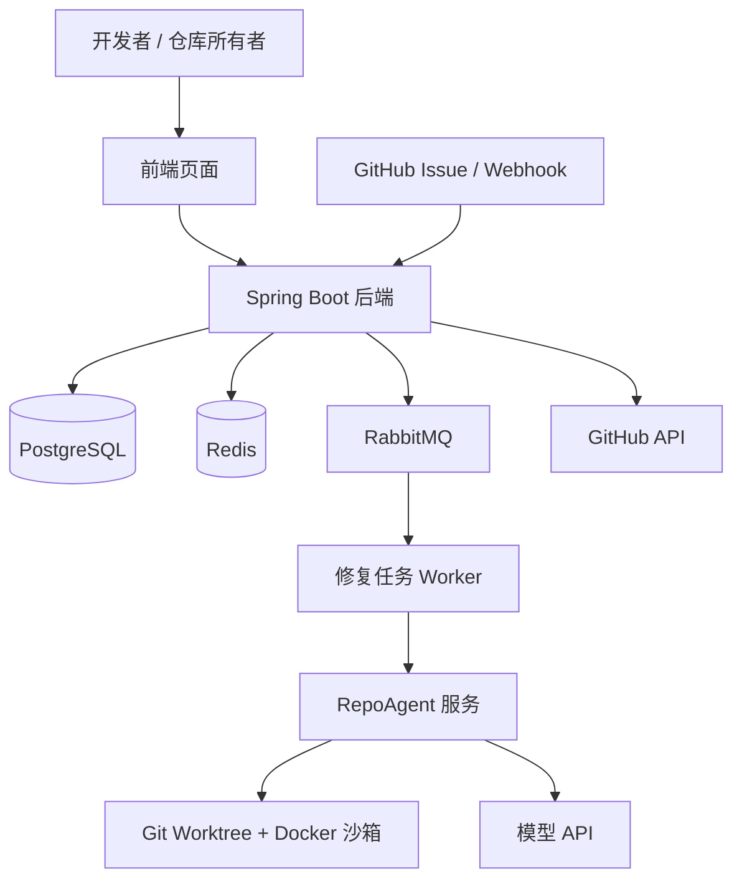
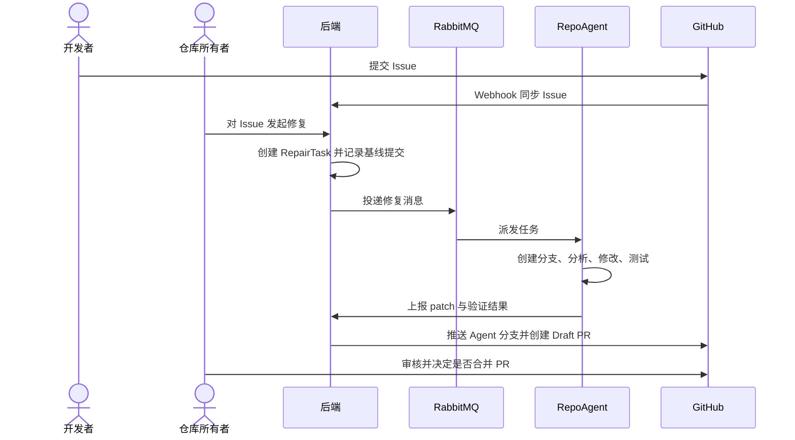

# 智能代码缺陷修复平台：项目概述

## 1. 项目背景

开源项目或团队项目通常有多个代码仓库，也会不断收到开发者提交的 Issue。仓库所有者需要阅读问题、定位代码、编写修复、运行测试并创建 Pull Request。简单问题也会占用不少维护时间。

本项目建设一个面向 GitHub 仓库的智能代码缺陷修复平台。平台接入多个仓库，允许开发者提交或同步 Issue；仓库所有者可以选择某个 Issue，调用 RepoAgent 分析问题并生成修复分支。RepoAgent 不自动合并代码，最终由仓库所有者审核并在 GitHub 中合并 Pull Request。

RepoAgent 是平台中的智能修复组件，负责代码分析、补丁生成和验证。Java 后端负责用户、仓库、Issue、任务、权限和 GitHub 分支/PR 等业务流程。

## 2. 应用场景

平台的核心场景如下：

1. 平台中存在多个 GitHub 代码仓库。
2. 多个开发者为仓库提交 Issue，或由 GitHub 自动同步已有 Issue。
3. 仓库所有者浏览并筛选 Issue。
4. 所有者对某个 Issue 点击“使用 RepoAgent 修复”。
5. 后端创建异步修复任务，RepoAgent 在独立环境中分析、修改和验证代码。
6. 修复完成后，系统为该 Issue 创建独立 Git 分支和 Draft Pull Request。
7. 所有者查看分析结果、代码 Diff 和测试结果，决定是否在 GitHub 合并该 PR。

平台的目标是帮助维护者减少重复的定位和修复工作，而不是代替维护者决定代码是否可以合并。

## 3. 用户角色

| 角色 | 可执行操作 |
|---|---|
| 开发者 | 查看授权仓库、创建/补充 Issue、查看 Issue 状态和修复进度 |
| 仓库所有者 | 绑定仓库、管理开发者、发起/取消修复、查看 Diff、创建 Draft PR、决定是否合并 |
| 平台管理员 | 管理用户、组织、系统配置和运行资源 |
| RepoAgent | 在被授权的仓库、提交和工作目录内分析与修改代码 |

仓库所有者是唯一能够发起修复和发布 PR 的角色。开发者提交 Issue 不代表 Agent 会自动修改代码。

## 4. 系统架构



系统分为两部分：

- **Spring Boot 后端**：处理用户登录、权限校验、仓库绑定、Issue 管理、修复任务、任务状态、PR 创建和结果展示。
- **RepoAgent 服务**：接收后端派发的修复任务，在指定目录执行 Coordinator、Implement、验证和产物保存。

RepoAgent 不直接管理平台用户，也不直接决定是否合并到主分支。

## 5. 技术栈

| 类别 | 技术选择 | 作用 |
|---|---|---|
| 后端语言 | Java 21 | 后端开发语言 |
| 后端框架 | Spring Boot、Spring MVC | REST API、业务服务和统一异常处理 |
| 权限认证 | Spring Security、GitHub OAuth | 用户登录、角色权限和 GitHub 授权 |
| 关系数据库 | PostgreSQL | 用户、仓库、Issue、任务、审批和 PR 记录 |
| 缓存 | Redis | 登录会话、热点仓库信息、简单限流和短期任务状态缓存 |
| 消息队列 | RabbitMQ | 异步执行耗时较长的 RepoAgent 修复任务 |
| Agent 服务 | Python、FastAPI、RepoAgent | 代码分析、修复、测试和生成 patch |
| 代码隔离 | Git worktree、Docker | 每个修复任务使用独立目录和测试环境 |
| GitHub 集成 | GitHub App / GitHub REST API | 同步 Issue、创建分支、推送代码和创建 Draft PR |
| 文件存储 | 本地目录或 S3 兼容对象存储 | 保存日志、patch、测试报告和运行轨迹 |

首版可采用 Spring Boot 单体后端加一个 RepoAgent 服务。PostgreSQL、Redis 和 RabbitMQ 可以通过 Docker Compose 启动，不需要一开始拆分大量微服务。

## 6. 核心功能

### 6.1 仓库管理

- 仓库所有者通过 GitHub App 或 OAuth 绑定仓库。
- 系统保存仓库名称、默认分支、GitHub 安装信息和修复策略。
- 所有者可以配置哪些成员能发起修复，以及每个任务的最大运行时间。

### 6.2 Issue 管理

- GitHub Webhook 将新 Issue、Issue 更新同步到平台。
- 开发者也可以在平台中创建 Issue。
- Issue 包含标题、描述、评论、提交人、状态和关联仓库。
- 所有者可为 Issue 添加标签，例如“待分析”“允许修复”“无需修复”。

### 6.3 RepoAgent 修复任务

- 所有者选择一个 Issue 后创建修复任务。
- 系统固定本次任务使用的 Issue 内容和仓库提交版本。
- RepoAgent 分析问题，生成修复说明、修改文件和 patch。
- Agent 在 Docker 沙箱中运行仓库指定的测试或静态检查。
- 系统保存最终 Diff、验证结果、日志和运行状态。

### 6.4 Draft PR 与人工审核

- 验证结束后，系统推送 Agent 分支并创建 Draft PR。
- PR 描述包含 Issue 链接、修改摘要、测试命令和结果。
- 所有者在平台或 GitHub 中查看 Diff。
- 平台不自动合并 PR，代码合并仍由 GitHub 和仓库所有者完成。

### 6.5 任务记录

- 查看任务当前阶段：排队、分析、修复、验证、完成或失败。
- 查看 Agent 的关键结论、修改文件、日志和测试结果。
- 支持取消仍在运行的任务。
- 支持失败后重新创建一个新任务，不覆盖旧任务记录。

## 7. 业务流程



一次修复任务的简单状态流转：

```text
CREATED → QUEUED → ANALYZING → FIXING → VALIDATING → PR_READY
                                     └──────────────→ FAILED
CREATED / QUEUED / ANALYZING / FIXING → CANCELLED
```

`PR_READY` 只表示 Agent 已生成分支和 Draft PR，不表示代码已合并，也不表示 Issue 已关闭。

## 8. 分支与并行修复

每个 Issue 的修复任务都创建独立 Git 分支，例如：

```text
repoagent/issue-128/run-001
repoagent/issue-142/run-001
repoagent/issue-151/run-001
```

每个分支同时创建一个独立的 Git worktree：

```text
/data/worktrees/repo-1/issue-128-run-001
/data/worktrees/repo-1/issue-142-run-001
/data/worktrees/repo-1/issue-151-run-001
```

`branch` 用于保存和推送修复提交，`worktree` 用于让多个任务在同一台服务器上拥有互不影响的代码目录。二者配合使用。

修复时的流程为：

```text
固定 main 当前提交 base_sha
→ 从 base_sha 创建 Agent 分支
→ 为该分支创建 worktree
→ RepoAgent 在 worktree 中修改和测试
→ 提交并推送分支
→ 创建 Draft PR
```

不同 Issue 可以并行修复，因为它们修改的是不同 worktree。第一版不自动解决多个 PR 之间的代码冲突：仓库所有者按 GitHub 的正常 PR 流程逐个合并；如果某个 PR 因主分支更新而冲突，可以人工处理或重新发起一次修复任务。

## 9. 常见后端问题与简单解决方式

| 问题 | 简单解决方案 |
|---|---|
| 用户重复点击“修复” | 前端按钮禁用；后端使用 `issue_id + base_sha + task_type` 查询是否已有进行中的任务 |
| GitHub Webhook 重复投递 | 使用 GitHub delivery ID 建唯一索引，已处理事件直接忽略 |
| 修复任务耗时太长 | HTTP 接口只创建任务并立即返回；实际修复通过 RabbitMQ 异步执行 |
| 多个任务同时修改同一仓库 | 每个任务创建独立 branch、worktree 和 Docker 容器 |
| Worker 异常退出 | 任务记录 `FAILED`，保留日志；所有者可重新发起新任务 |
| Agent 测试失败 | 保存失败日志和 patch，任务标记为 `FAILED`，不创建 PR 或只创建供人工查看的 Draft PR |
| Redis 短暂不可用 | Redis 只用于缓存和限流，任务真实状态始终保存在 PostgreSQL |
| 用户刷新页面看不到进度 | 前端轮询任务状态，后续可增加 SSE 实时推送 |
| 多人同时审核或取消任务 | 数据库任务表使用 `version` 字段做乐观锁，避免旧请求覆盖新状态 |
| GitHub 创建 PR 超时 | 根据分支名和 Issue 编号查询是否已经创建，避免重复创建 PR |

首版重点是“任务不重复、代码目录不共享、状态能查询、失败有记录”。不需要为了少量并发任务引入复杂的分布式锁、合并队列或微服务编排系统。

## 10. 核心数据表

| 表名 | 核心字段 | 用途 |
|---|---|---|
| `user` | id、github_id、name、role | 平台用户 |
| `repository` | id、owner_id、github_repo_id、name、default_branch | 已绑定仓库 |
| `issue` | id、repository_id、github_issue_id、title、body、status | 缺陷信息 |
| `repair_task` | id、issue_id、base_sha、status、branch_name、version、created_at | 一次修复任务 |
| `agent_run` | id、task_id、status、started_at、finished_at、log_path | Agent 实际执行记录 |
| `patch_artifact` | id、task_id、patch_hash、diff_path、changed_files | Agent 生成的补丁 |
| `validation_result` | id、task_id、command、exit_code、status、report_path | 测试和验证结果 |
| `pull_request` | id、task_id、github_pr_number、branch_name、status | Agent 创建的 Draft PR |
| `webhook_event` | id、delivery_id、event_type、status、received_at | GitHub 事件去重记录 |

`repair_task` 是最重要的业务表。它关联 Issue、基线提交、Agent 分支、运行状态和最终 PR，因此可以完整回答“这个 Issue 是否被修复过、基于什么代码修复、结果如何”。

## 11. 简单接口设计

| 接口 | 作用 |
|---|---|
| `POST /api/repositories` | 绑定 GitHub 仓库 |
| `GET /api/repositories/{id}/issues` | 查看仓库 Issue 列表 |
| `POST /api/issues/{id}/repair-tasks` | 仓库所有者发起修复任务 |
| `GET /api/repair-tasks/{id}` | 查看任务状态、分析结果和验证结果 |
| `POST /api/repair-tasks/{id}/cancel` | 取消运行中的任务 |
| `POST /api/repair-tasks/{id}/retry` | 基于当前 Issue 创建新的修复任务 |
| `GET /api/repair-tasks/{id}/artifacts` | 查看 patch、日志和验证报告 |
| `POST /api/github/webhook` | 接收 GitHub Issue 和 PR 事件 |

发起修复接口只允许仓库所有者或维护者调用。接口立即返回 `task_id`，前端随后通过查询接口获取进度。

## 12. RepoAgent 与后端的边界

```text
Spring Boot 后端
  - 谁能访问仓库
  - 哪个 Issue 可以修复
  - 何时创建任务
  - 分支和 PR 的发布
  - 数据库记录与任务状态

RepoAgent
  - 读取指定仓库代码
  - 根据 Issue 分析问题
  - 在指定 worktree 生成 patch
  - 运行测试并返回结果
  - 保存运行轨迹和修复产物
```

后端向 RepoAgent 传递固定的 `repository`、`base_sha`、`issue`、`branch_name`、`worktree_path` 和资源限制。RepoAgent 返回结构化的分析、patch、验证结果和日志路径。

RepoAgent 不能自行访问任意仓库、创建主分支提交或执行未授权的 GitHub 发布操作。

## 13. 实施顺序

1. 搭建 Spring Boot 基础项目，完成用户、仓库、Issue 和 PostgreSQL 表结构。
2. 接入 GitHub OAuth/App，完成仓库绑定和 Issue Webhook 同步。
3. 创建 RepairTask、RabbitMQ Worker 和任务详情页面，先使用模拟 Agent 验证异步流程。
4. 将 RepoAgent 接入 Worker，为每个任务创建 branch、worktree 和 Docker 沙箱。
5. 保存 patch 与测试结果，接入 GitHub 分支推送和 Draft PR 创建。
6. 增加 Redis 缓存、任务取消、乐观锁和基础日志监控。

完成上述六步后，平台已经能处理完整的“开发者提交 Issue → 所有者调用 RepoAgent → 生成分支与 Draft PR → 所有者合并”的业务场景。
