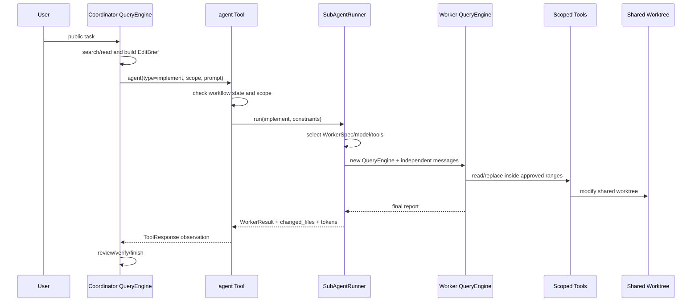

# 第三周学习讲义：Coordinator 多 Agent

## 学习目标

完成本周后，你应能画出 Coordinator 调用 Worker 的完整消息与权限边界，解释为什么拆角色不是为了“多调用几个模型”，并能从一次 `agent(type=implement)` 追踪到受限代码替换和 WorkerResult 返回。

本周必须阅读：

1. `repo_agent/core/coordinator.py`：Coordinator 的对象装配和 run 主链。
2. `repo_agent/core/subagent.py`：WorkerSpec、WorkerConstraints、SubAgentRunner 和 scoped tools。
3. `repo_agent/tools/agent_tools.py`：agent 元工具与确定性工作流状态机。
4. `repo_agent/core/semantic_evidence.py`：RepairBrief 与公开语义证据。

第二层阅读：

5. `repo_agent/core/verification.py`：验证结果如何分类。
6. `repo_agent/core/task_constraints.py`：少量任务相关约束如何路由。

不要顺序阅读整个 `agent_tools.py`。先跟 `reset_agent_tool_state → build_agent_tools → launch_agent → runner.run`，再看 Implement、PatchReview 和 Verify 的分支。

## 1. Coordinator 不是另一个框架

Coordinator 仍使用第一周的 QueryEngine 和 query_loop。差别只在它的 ToolRegistry：

```text
普通 RepoAgent Registry
  -> read/write/search/run/finish

Coordinator Registry
  -> 少量只读仓库工具
  -> agent 元工具
  -> 可选候选/公开验证状态工具
```

当模型调用 `agent` 时，程序才创建一个新的 QueryEngine 运行 Worker。因此多 Agent 是同一个 Runtime 的递归组合，而不是第二套 loop。

## 2. 完整调用路径



共享的是仓库文件；不共享的是 messages、system prompt、工具集、max steps、短期记忆和输出目录。

## 3. 为什么用 Coordinator 模式

仓库修复包含两类认知任务：

- 定位与契约：应该修改哪个语义层、输入输出是什么、哪些旧行为不能变。
- 局部实现：在已知范围内把契约落实成最小代码改动。

单 Agent 容易在边搜索边修改时逐渐扩大范围，也容易把早期猜测当成事实。Coordinator 把定位结果写成 EditBrief，再交给没有全仓搜索权限的 Implement，从而让失败可以归因：scope 错多半是 Coordinator，scope 对但逻辑错多半是 Implement。

代价是额外 token、上下文转换损失和编排复杂度。因此短任务不应该机械派 Research、Plan、Review 全套 Worker。

## 4. WorkerSpec 是角色能力声明

WorkerSpec 包含：

```python
WorkerSpec(
    name="implement",
    allowed_tools={"read_file", "replace_in_file", "write_file"},
    system_prompt=IMPLEMENT_PROMPT,
    max_steps=8,
    can_write=True,
)
```

Research 有 search/read，没有写工具；PatchReview 只有 read/diff；FailureReview 没有工具，只消费控制器提供的失败证据；Implement 能写，但没有 search、git diff 和 run command。

角色不是人格标签，而是 system prompt、能力集合、预算和输出契约的组合。

## 5. WorkerConstraints 把 EditBrief 变成能力边界

```json
{
  "allowed_files": ["src/parser.py"],
  "allowed_ranges": {"src/parser.py": [[120, 155]]},
  "context_ranges": {"src/types.py": [[20, 48]]}
}
```

`allowed_ranges` 可读可写；`context_ranges` 只读；未出现的文件不可访问。Implement 的 scoped Registry 只包含重新包装后的 read/replace/write。

自然语言 EditBrief 解释为什么改，WorkerConstraints 决定实际上能改哪里。前者是语义契约，后者是执行能力。

## 6. Scoped Implement 如何工作

受限 `read_file` 要求显式行范围，并检查请求被 allowed/context ranges 完整包含。

`replace_in_file` 支持两种模式：

- `line_replacements`：基于 Coordinator 批准的原始行号，工具把基线行映射到当前文件。
- `old/new`：精确文本替换；多次出现时必须指定 occurrence。

工具还检查替换重叠、旧文本不存在、行号漂移和最终 diff 是否逃出批准范围。已有且有 range 的文件不能用 `write_file` 整体重写。

这解决的是 blast radius，不保证修改语义正确。范围内仍可能写出错误逻辑，因此还需要测试或 Review。

## 7. Worker 为什么必须看不到主对话

独立上下文能减少无关搜索日志、历史失败方案和 Coordinator 自言自语对 Implement 的污染，也使每个 Worker 的 token 和 trace 可单独统计。

代价是 Coordinator 必须写自包含 prompt。`_worker_prompt()` 明确告诉 Worker 看不到主对话，因此任务必须包含目标、事实、Problem Contract、允许范围、旧行为不变量和输出格式。写“根据上面的分析修改”会造成上下文丢失。

## 8. agent_tools 是确定性控制器

Coordinator prompt 描述期望流程，但 `agent_tools.py` 才执行状态转换。核心状态包括：

```text
ready_to_implement
implementation_done
patch_review_done
verify_attempted
corrective_implement_count
workflow_terminal_reason
worker_attempts
```

因此模型即使忘记流程，也无法无限重复 Research、在 Implement 后重新研究、跳过必须 Review，或使用超过预算的 corrective。

这是一种混合架构：LLM 负责开放式决策，代码状态机负责不可违反的流程约束。

## 9. RepairBrief 是角色间中间表示

RepairBrief 包含：

```text
problem_contract：触发输入和期望行为
semantic_cases：目标及相邻行为分区
contract_edges：producer 到 consumer 的契约关系
verification_plan：公开、可执行验证
unknowns：尚未证明的事实
confidence：证据质量
candidate_policy：是否值得支付候选成本
```

它不是 patch 方案。`build_repair_brief()` 只压缩公开证据，不应该根据证据自动推导具体修改，否则错误假设会被升级成所有 Worker 的硬约束。

## 10. Direct evidence 与 inference

Direct evidence 是输入中可定位的事实，例如 issue 明确异常类型、源码 docstring 明确 API 不支持 inverse、真实公开命令给出 expected/actual。

Inference 是从事实推导的判断，例如“问题可能在消费者层”“这个 guard 可能太宽”。Inference 可以引导研究，但不应独自触发不可逆或高置信 corrective。

Unknown 应显式保留，不能为了让 JSON 完整而猜成 direct。

## 11. Review 与 Verify 的区别

PatchReview 读取 diff 和少量源码，检查 wrong layer、过宽 guard、共享状态、公共 API 和旧行为风险。它输出风险归因，但不能证明 patch 正确。

Verify 运行一条经过验证计划约束的公开命令，提供行为证据。测试通过也只覆盖该命令包含的行为，不等于不存在其他回归。

确定性门禁负责语法、文件范围、测试文件禁写等客观规则；LLM Review 只处理难以编码的语义风险。

## 12. 普通模式与 SWE-bench profile

普通维护模式可使用 Research、Implement、PatchReview、Verify 和必要 corrective，适合真实仓库交互。

SWE-bench benchmark 默认使用简化 pass@1 路径：少量定位、一次 scoped Implement、确定性检查、最终 patch；不把 harness 失败反馈回 Agent。候选池默认关闭，PatchReview 只在确定性风险触发时运行。

Experience-build 才允许初始 harness 后启动 FailureReview 和最多一次 Corrective Implement。不要把两个模式混为一谈。

## 13. task_constraints.py 的定位

任务 profile 同时匹配公开 issue 特征和已批准源码范围，才注入额外语义约束。这比仅按关键词路由可靠，但它仍带有针对历史失败类型的经验规则，存在覆盖范围有限和 test-set adaptation 风险。

理解 Coordinator 主线时先跳过具体 Matplotlib/Django/sklearn profile；它们不是多 Agent 架构的必要部分，而是后期实验形成的增强层。

## 每日安排

### Day 1

阅读 CoordinatorEngine 的构造和 run，画出 Coordinator 自己的 Registry。回答它为什么仍然是 QueryEngine。

### Day 2

阅读 WorkerSpec、工具白名单和 max steps。制作一张角色/输入/工具/输出/风险表。

### Day 3

跟踪一次 `agent(type=research)`，解释 WorkerResult 如何回到 Coordinator，而 messages 为什么不合并。

### Day 4

跟踪一次 scoped Implement，手工测试范围内替换、越界替换、整文件读取和 test 文件写入。

### Day 5

阅读 agent_tools 的 launch_agent，只整理五个主要状态转换：research、implement、review、verify、finish。

### Day 6

阅读 RepairBrief，选择一个真实 Issue，亲手写 problem contract、semantic cases、old behavior invariants 和 allowed ranges。

### Day 7

用 10 分钟白板讲完整调用链，并解释哪些边界由 prompt 实现，哪些由 Registry、scope 和状态机实现。

## 自测问题

1. Coordinator 与普通 RepoAgent 的底层 loop 有什么不同？
2. Worker 与 Coordinator 共享什么，不共享什么？
3. WorkerSpec、EditBrief、WorkerConstraints 分别解决什么？
4. 为什么 Implement 不能 search_repo、git_diff 和 run_command？
5. allowed_ranges 与 context_ranges 有什么区别？
6. 独立上下文为什么既能减少污染，也会造成信息损失？
7. agent_tools 为什么需要独立于 messages 的状态？
8. PatchReview 为什么不能代替测试？
9. Direct evidence、inference、unknown 如何影响 corrective？
10. 为什么增加 Worker 数量可能降低修复率？

## 本周实践验收

构造一个 30 行示例仓库和 FakeLLM：Coordinator 先读文件，再派 Implement 修改第 10-12 行。分别测试合法替换、修改第 20 行、读取整文件、重复派 Implement、Worker 达到 max steps。最后从主 trace 和 `subagents/` trace 解释每次拒绝发生在哪一层。
